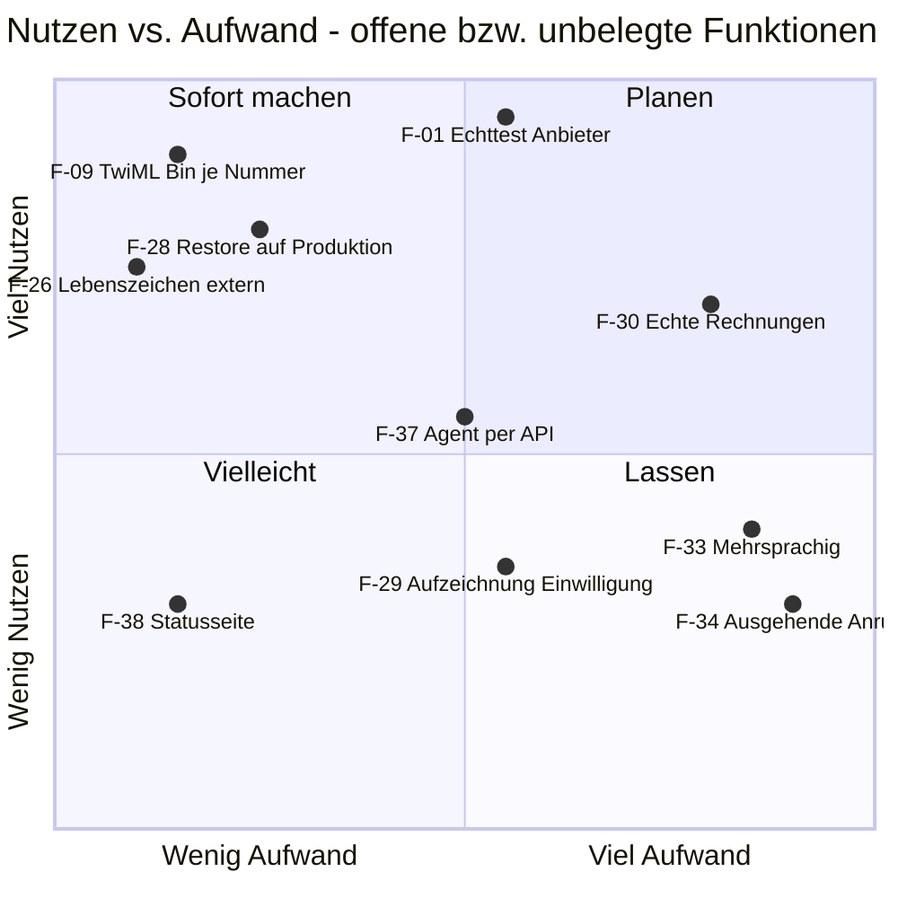

# MVP-Umfang: KI-Telefonzentrale

> Phase 5 im Modus „Bestehende App“. Die Funktionen sind aus dem Code **rekonstruiert** (Stand 2026-10-24, nach Commit `f605d85`) und nach dem Ziel aus `B0-ziel.md` priorisiert: Verkauf an die ersten zahlenden Handwerks- und Dienstleistungsbetriebe.
> „Muss“ heißt hier: muss vor dem ersten zahlenden Kunden **funktionieren und nachgewiesen sein**. Die meisten Muss-Funktionen sind gebaut; offen ist vor allem der Nachweis mit echten Konten (siehe Spalte „Ist“).
> Akzeptanzkriterien und Tests stehen in `19-tests.md` (IDs `AK-F<nr>-<n>`, `TEST-F<nr>-<n>`), Aufgaben in `21-roadmap.md`.

## Kernfunktion
Ein Anrufer erreicht den Betrieb jederzeit: Die Telefon-KI meldet sich mit dem Firmennamen, legt offen, dass sie eine KI ist, nimmt das Anliegen auf, bucht einen Termin oder stellt im Notfall durch – und der Betrieb sieht alles sofort im Portal.

## Funktionen

Legende Ist: **fertig** (gebaut, mit automatischem Test) · **fertig, unbelegt** (gebaut, Nachweis mit echten Anbieter-Konten fehlt) · **teilweise** · **offen** (nicht gebaut).
Machbarkeit: 🟢 gängig · 🟡 braucht Zusatz (externer Dienst, Genehmigung) · 🔴 unklar/riskant.

| ID | Funktion | Priorität | Ist | User Story | Aufwand (S/M/L) | 🔒 Risiko-Markierung | Machbarkeit (grob) | Akzeptanzkriterien |
|---|---|---|---|---|---|---|---|---|
| F-01 | Anrufannahme: Twilio-Nummer → Mandant → gewählte Sprach-KI (Retell, Vapi, ElevenLabs; SIP-Anbieter „nicht freigegeben“) mit Mandanten-Variablen | Muss | fertig, unbelegt | Als Inhaber möchte ich, dass jeder Anruf auf meiner Nummer von der KI angenommen wird, damit kein Kunde verloren geht. | L | Kosten (Minuten), Daten an Dritte | 🟡 drei externe Anbieter, Formate nur aus Doku umgesetzt (B1 BF-17) | AK-F01-1, AK-F01-2 |
| F-02 | KI-Offenlegung und Aufzeichnungshinweis in der Begrüßung, nicht abschaltbar | Muss | fertig | Als Anrufer möchte ich wissen, dass ich mit einer KI spreche und ob aufgezeichnet wird, damit ich entscheiden kann. | S | Recht (Art. 50 KI-VO [Q-010], § 201 StGB [Q-011]) | 🟢 Textbaustein, Test vorhanden | AK-F02-1 |
| F-03 | Anrufer-Erkennung nur über die verifizierte Anrufernummer (keine Daten zu genannten Fremdnummern) | Muss | fertig | Als Bestandskunde möchte ich mit Namen begrüßt werden, damit ich nicht alles neu sagen muss. | M | teilt Daten (Telefon) | 🟢 Server prüft gegen Anrufzeile | AK-F03-1, AK-F03-2 |
| F-04 | Anliegen aufnehmen: Kunde speichern (`save_customer`), Kategorie, Dringlichkeit, Vorgang mit Vorgangsnummer | Muss | fertig, unbelegt | Als Inhaber möchte ich jedes Anliegen strukturiert als Vorgang bekommen, damit ich nichts nachtelefonieren muss. | M | personenbezogene Daten Dritter, ggf. Gesundheitsangaben im Transkript | 🟢 | AK-F04-1 |
| F-05 | Terminvorschläge und Buchung (`find_technician`, `book_appointment`) mit Zuständigkeit nach PLZ und Kalender intern / Outlook / Google, Doppelbuchungsschutz | Muss | fertig, unbelegt | Als Anrufer möchte ich am Telefon direkt einen Termin bekommen, damit ich nicht auf Rückruf warten muss. | L | – | 🟡 Kalender-APIs (Microsoft Graph, Google OAuth-Verifizierung offen) | AK-F05-1, AK-F05-2 |
| F-06 | Termin per Telefon verschieben oder absagen (`find_appointments`, `reschedule_appointment`, `cancel_appointment`), nur zur verifizierten Nummer | Sollte | fertig, unbelegt | Als Kunde möchte ich meinen Termin telefonisch verschieben, damit ich niemanden erreichen muss. | M | ändert Daten per Telefon | 🟢 | AK-F06-1 |
| F-07 | Notfall: Erkennung nach Branchenleitfaden, Hinweis auf 112, `escalate_emergency`, Durchstellung an Notdienst, Notfall-Alarm per SMS/E-Mail | Muss | fertig, unbelegt | Als Anrufer mit Wasserrohrbruch möchte ich sofort einen Menschen erreichen, damit der Schaden begrenzt wird. | M | Kosten (SMS), Haftung | 🟡 Durchstellung hängt an Anbieter (`transfer_call`) und Paket-Feature | AK-F07-1, AK-F07-2 |
| F-08 | Rückruf-Vorgang bei Auflegen, Tool-Fehler, Wunsch nach einem Menschen oder fehlendem Termin | Muss | fertig | Als Inhaber möchte ich auch abgebrochene Gespräche sehen, damit kein Lead verloren geht. | S | – | 🟢 | AK-F08-1 |
| F-09 | Fallback: Pause, Kontingent erschöpft, Kostenschutz, KI-Störung → Weiterleitung auf Fallback-Nummer bzw. Mailbox; Ersatzziel als TwiML Bin bei Twilio für Serverausfall | Muss | fertig, unbelegt (TwiML Bin noch nicht je Nummer gesetzt) | Als Inhaber möchte ich, dass Anrufe auch bei Störungen ankommen, damit ich erreichbar bleibe. | M | – | 🟡 Einrichtung je Nummer in der Twilio-Konsole | AK-F09-1, AK-F09-2 |
| F-10 | Benachrichtigungen per E-Mail/SMS (Bestätigung an Anrufer, Info an Mitarbeiter, Notfall-Alarm) außerhalb des Gesprächspfads mit Wiederholung | Muss | fertig | Als Techniker möchte ich neue Termine sofort aufs Handy bekommen, damit ich planen kann. | M | Kosten (SMS), versendet Daten | 🟡 SMTP/SMS-Anbieter, Zustellbarkeit (SPF/DKIM) | AK-F10-1, AK-F10-2 |
| F-11 | Terminerinnerung an Kunden per E-Mail/SMS (Standard: aus, E-008) | Sollte | fertig | Als Inhaber möchte ich Kunden an Termine erinnern, damit weniger Termine platzen. | S | Kosten (SMS), Werberecht/Einwilligung (UWG [Q-014]) | 🟢 | AK-F11-1 |
| F-12 | Portal-Startseite (Hub): Vorgänge live, Kennzahlen, Auslastung, Vorgang bearbeiten (Status, Notiz, Benachrichtigung erneut senden) | Muss | fertig | Als Büro-Mitarbeiterin möchte ich alle neuen Vorgänge auf einen Blick sehen, damit ich schnell reagiere. | M | – | 🟢 | AK-F12-1 |
| F-13 | Anrufliste mit Zusammenfassung, Transkript, Dauer, Status und Aufnahme (Wellenform-Player, Auslieferung nur über eigenen Endpunkt mit Berechtigungsprüfung) | Muss | fertig | Als Inhaber möchte ich ein Gespräch nachlesen oder anhören, damit ich Rückfragen klären kann. | M | sensible Inhaltsdaten | 🟢 | AK-F13-1, AK-F13-2 |
| F-14 | Kundenverwaltung mit Suche, Vorgängen, DSGVO-Auskunft (Export) und endgültiger Löschung inkl. Anbieter | Muss | fertig | Als Kunden-Admin möchte ich Auskunfts- und Löschanfragen erfüllen, damit ich DSGVO-konform bin. | M | Export/Löschung personenbezogener Daten | 🟢 | AK-F14-1, AK-F14-2 |
| F-15 | Team und Einsatzgebiete: Mitarbeiter, PLZ-Bereiche, Kategorien, Direktnummer für Notfälle | Muss | fertig | Als Inhaber möchte ich festlegen, wer wofür und wo zuständig ist, damit die KI richtig verteilt. | M | Beschäftigtendaten | 🟢 | AK-F15-1 |
| F-16 | Einstellungen Unternehmen & KI: Firmenname, Branche (Vorlagen), Begrüßung, FAQ, Preise, Sicherheitsregeln, Geschäftszeiten, Termindauer, Notfall-Einstellungen, Datenschutz-URL | Muss | fertig | Als Inhaber möchte ich der KI mein Wissen geben, damit sie richtig antwortet. | M | Prompt-Inhalt aus Kundenhand (Injection-Fläche) | 🟢 | AK-F16-1 |
| F-17 | Integrationen: Microsoft 365 (Graph), Google Kalender (OAuth), Anleitung Rufumleitung | Sollte | fertig, unbelegt | Als Inhaber möchte ich meinen bestehenden Kalender nutzen, damit es keine Doppelbuchung gibt. | M | Token-Speicherung, weitreichende Graph-Rechte (OP-14-13) | 🟡 Google-Verifizierung, Microsoft Publisher Verification | AK-F17-1 |
| F-18 | Konten und Zugang: Ersteinrichtung, Einladung, Login, Passwort vergessen, 2FA (TOTP, Pflicht für Plattform-Admin), Re-Auth, Sitzungen, Rollen (Plattform-Admin, Kunden-Admin, Mitarbeiter) | Muss | fertig | Als Kunden-Admin möchte ich Mitarbeiter einladen und Rechte vergeben, damit jeder nur sieht, was er braucht. | L | Konten, Rollen | 🟢 | AK-F18-1, AK-F18-2, AK-F18-3 |
| F-19 | Aktivitätsprotokoll (Audit-Log) und Nachrichtenprotokoll für Kunden | Muss | fertig | Als Kunden-Admin möchte ich sehen, wer was geändert hat und welche Nachricht rausging, damit ich Fehler nachvollziehe. | S | – | 🟢 | AK-F19-1 |
| F-20 | Tarif & Verbrauch für Kunden: Paket, Minuten, Verlauf, voraussichtliche Rechnung; Warnung bei 80 % / 100 % des Kontingents | Muss | fertig | Als Inhaber möchte ich meinen Verbrauch sehen und rechtzeitig gewarnt werden, damit es keine Überraschung gibt. | S | Kosten | 🟢 | AK-F20-1 |
| F-21 | Plattform-Verwaltung (Leitstand): Kunden anlegen, Status/Pause, Rufnummern, Zugänge, Sprach-KI je Kunde/Nummer, Support-Zugriff („Portal öffnen“) | Muss | fertig | Als Betreiber möchte ich Kunden einrichten und betreuen, damit ich die Plattform verkaufen kann. | L | Admin sieht alle Mandanten | 🟢 | AK-F21-1, AK-F21-2 |
| F-22 | Pakete & Preise mit serverseitig durchgesetzten Grenzen (Zugänge, Rufnummern, Terminbuchung, E-Mail, Notfall-Durchstellung, eigene Begrüßung/FAQ, eigener Agent) | Muss | fertig (Ausnahme: Feature „Aufzeichnung“ hängt an E-010) | Als Betreiber möchte ich Leistungen je Paket verkaufen, damit sich Preise unterscheiden. | M | Freischaltung nur serverseitig | 🟢 | AK-F22-1 |
| F-23 | Abrechnung: Monatsvorschau je Kunde, Einkaufskosten, CSV; Dauer laut Twilio-Statusmeldung als Grundlage (E-006) | Muss | teilweise (keine echten Rechnungen, siehe F-30) | Als Betreiber möchte ich je Kunde Minuten und Betrag sehen, damit ich korrekt abrechne. | M | Geld | 🟢 | AK-F23-1 |
| F-24 | Verbindungen: Anbieter-Schlüssel und Plattform-Einstellungen in der Oberfläche, verschlüsselt gespeichert, Testfunktion | Muss | fertig | Als Betreiber möchte ich Anbieter ohne Server-Zugang einrichten, damit Änderungen schnell gehen. | M | Geheimnisse in der DB (AES-256-GCM) | 🟢 | AK-F24-1 |
| F-25 | Kostenschutz: Notschalter, gleichzeitige Anrufe je Kunde und gesamt, maximale Gesprächsdauer, Tagesbudget, Anrufe je Nummer und Stunde | Muss | fertig | Als Betreiber möchte ich Kosten nach oben begrenzen, damit Missbrauch mich nicht ruiniert. | M | Kosten (Denial of Wallet) | 🟢 | AK-F25-1, AK-F25-2 |
| F-26 | Überwachung und Alarme (Notfall-Alarm nicht zugestellt, Backup, Plattenplatz, hängende Anrufe, Twilio-Konfiguration) + externer Lebenszeichen-Ping | Muss | fertig, unbelegt (externer Dienst nicht eingerichtet) | Als Betreiber möchte ich bei Störungen sofort alarmiert werden, damit Kunden nichts merken. | M | – | 🟡 externer Dienst nötig | AK-F26-1 |
| F-27 | Löschfristen je Kunde inkl. Löschung bei Retell/Twilio/weiteren Anbietern; Mandanten-Gesamtexport und -Löschung (Offboarding) | Muss | fertig, unbelegt (Anbieter-Löschung nie mit echtem Konto belegt) | Als Betreiber möchte ich Daten fristgerecht überall löschen, damit ich als Auftragsverarbeiter korrekt handle. | M | Löschung, Daten bei Dritten | 🟡 Anbieter-APIs | AK-F27-1, AK-F27-2 |
| F-28 | Verschlüsselte externe Backups mit monatlichem Wiederherstellungstest | Muss | fertig, unbelegt (Produktionsserver fehlt) | Als Betreiber möchte ich nach einem Serververlust alles wiederherstellen, damit kein Kunde Daten verliert. | M | Backup enthält alle Daten | 🟢 | AK-F28-1 |
| F-29 | Aufzeichnung mit ausdrücklicher Einwilligung (Variante C aus `docs/recht/aufzeichnung.md`): Einstellung „Ausdrücklich fragen“, Tool `recording_consent`, Löschung der Aufnahme nach „Nein“; dazu SMS-Einwilligung (`smsConsent`) | Sollte | in Arbeit (Arbeitsstand 2026-10-24, noch nicht committet) | Als Inhaber möchte ich Gespräche nur mit Einwilligung aufzeichnen, damit ich rechtssicher bin. | M | Recht (§ 201 StGB [Q-011]) | 🔴 rechtlich ungeklärt (Fachperson), Löschung nach „Nein“ beim Anbieter nie mit echtem Konto belegt | AK-F29-1 |
| F-30 | Echte Rechnungen (Nummernkreis, PDF, GoBD), Zahlung (SEPA/Karte), Mahnwesen | Sollte | offen | Als Betreiber möchte ich Rechnungen automatisch stellen, damit ich nicht von Hand fakturiere. | L | Zahlung, Aufbewahrungspflicht [Q-016] | 🟡 Zahlungsanbieter, Steuerberatung | AK-F30-1 |
| F-31 | Self-Service Paketwechsel und „Mehr Minuten buchen“ | Später | offen | Als Inhaber möchte ich mein Paket selbst wechseln, damit ich nicht anrufen muss. | M | Geld | – | – |
| F-32 | Rufnummern in der Oberfläche kaufen/portieren, Twilio-Konfiguration per API, sipgate | Später | offen (Konfiguration wird heute nur geprüft) | Als Betreiber möchte ich Nummern per Klick einrichten, damit keine Konsolenfehler passieren. | L | – | – | – |
| F-33 | Stimme und Sprache je Kunde (DE/EN/TR), Texte mehrsprachig | Später | offen | Als Inhaber möchte ich englischsprachige Anrufer bedienen, damit ich mehr Kunden erreiche. | L | – | – | – |
| F-34 | Ausgehende Anrufe (Rückruf, Erinnerung, Kampagnen) | Später | offen | – | L | Recht (UWG § 7 [Q-014]), Kosten | – | – |
| F-35 | Weitere Anbindungen: CalDAV/Apple, CRM (HubSpot, Pipedrive), Webhooks für Kunden, Wissensdatenbank | Später | offen | – | L | Daten an Dritte | – | – |
| F-36 | Abwesenheiten und Urlaub im internen Kalender | Später | offen | – | M | Beschäftigtendaten | – | – |
| F-37 | Agent-Einrichtung per API (Prompt und Tools versioniert, Abgleich mit Server-Schema) statt Copy-Paste | Sollte | teilweise (Konsistenztest vorhanden, Provisionierung fehlt) | Als Betreiber möchte ich Prompt-Änderungen nachvollziehbar ausrollen, damit kein Abtippfehler Kundendaten verfälscht. | M | – | 🟡 Anbieter-APIs | AK-F37-1 |
| F-38 | Öffentliche Statusseite | Später | offen | – | S | – | – | – |
| F-39 | Test-Kunde mit Beispieldaten (nur in der Testumgebung) | Sollte | fertig | Als Betreiber möchte ich Interessenten eine gefüllte Oberfläche zeigen, ohne echte Daten. | S | darf nicht in Produktion laufen | 🟢 | AK-F39-1 |
| F-40 | Lokale Sprach-KI auf eigenem GPU-Server | Nie | – (erst ab mehreren tausend Minuten/Monat neu bewerten [ANNAHME A-006]) | – | L | – | – | – |

**Ehrliche Einordnung:** 25 Muss-Funktionen sind viel, aber fast alle sind gebaut. Der Engpass ist nicht Programmierung, sondern **Nachweis** (echte Anrufe je Anbieter, Produktionsserver, Verträge). Neue Funktionen (F-29 ff.) sollten erst nach dem Soft Launch (M5 in `21-roadmap.md`) angefasst werden.

## Bewusst NICHT in Version 1
- Aufzeichnung als verkauftes Paket-Feature – erst wenn F-29 fertig, rechtlich geklärt und mit echtem Konto belegt ist; bis dahin Empfehlung „ohne Tonaufzeichnung“ (offene Entscheidung E-010).
- F-31 Self-Service-Paketwechsel, F-32 Nummernkauf, F-33 Mehrsprachigkeit, F-34 ausgehende Anrufe, F-35 weitere Anbindungen, F-36 Abwesenheiten, F-38 Statusseite.
- F-40 eigene KI-Infrastruktur.
- Öffentliche Selbstregistrierung von Kunden: Kunden werden vom Betreiber angelegt (Einladung), es gibt keine offene Registrierung.

## Rahmen
- Ziel-Termin: Soft Launch mit 1–2 Pilotbetrieben, sobald M-S bis M4 in `21-roadmap.md` erledigt sind; kein festes Datum [ANNAHME A-001].
- Zeitbudget pro Woche: nicht festgelegt [ANNAHME A-002] – Umfang der Roadmap ist deshalb in Meilensteinen statt Kalenderwochen geplant.

## Matrix

