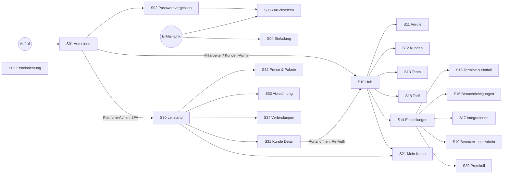

# Screens & Navigation

> Phase 7 im Modus „Bestehende App“: rekonstruiert aus `src/app/**/page.tsx`, `src/components/Sidebar.tsx` und `src/app/(app)/settings/layout.tsx` (Stand 2026-10-24, Glas-Design „Mint auf Glas“). Rollen und Rechte im Detail: `12-berechtigungen.md`.
> **Wichtig:** Ausgeblendete Menüpunkte sind keine Sicherheit. Jede Seite lädt ihre Daten über API-Routen, die Rolle und Mandant serverseitig prüfen (`requireTenant`, `requirePlatformAdmin`, `requireRecentAuth`; Antwortstrategie in `docs/sicherheit.md`).

## Navigation
Typ: **schwebende Icon-Leiste** links (Desktop, `nav aria-label="Hauptnavigation"`) bzw. **untere Leiste** (Handy); rechte Spalte mit Profil und Schnellaktionen; Einstellungen mit eigener Reiter-Leiste.

| Rolle | Hauptbereiche |
|---|---|
| Mitarbeiter / Kunden-Admin (Portal) | Hub · Anrufe · Kunden · Team · Tarif · Einstellungen · (Mein Konto, Abmelden) |
| Plattform-Admin (Verwaltung) | Leitstand · Preise & Pakete · Abrechnung · Verbindungen · (Mein Konto, Abmelden) |
| Plattform-Admin im Support-Zugriff | Portal-Navigation eines Kunden + „Verwaltung“ zurück; Banner zeigt den geöffneten Kunden (`TenantBanner`) |

Zusätzlicher Kanal ohne Bildschirm: das **Telefongespräch** selbst (FL-01 bis FL-06 in `06-flows.md`).

## Screen-Liste
| ID | Screen | Zweck | Sichtbar für | Erreichbar von | Wichtigste Elemente | Flows |
|---|---|---|---|---|---|---|
| S01 | Anmelden (`/login`) | Login mit E-Mail und Passwort, danach 2. Faktor | alle (nicht angemeldet) | Start, jede geschützte Seite bei 401 | Formular, Schritt „Zwei-Faktor-Anmeldung“, Link „Passwort vergessen“, Teal-Band mit Leistungen | FL-08 |
| S02 | Passwort vergessen (`/forgot`) | Reset-Link anfordern | alle | S01 | E-Mail-Feld, neutrale Bestätigung mit nächsten Schritten, „Erneut senden“ | FL-08 |
| S03 | Passwort zurücksetzen (`/reset/[token]`) | Neues Passwort setzen | Inhaber eines gültigen Links | E-Mail-Link | Passwortfelder, Prüfung gegen geleakte Passwörter | FL-08 |
| S04 | Einladung annehmen (`/invite/[token]`) | Zugang aktivieren | eingeladene Person | E-Mail-Link | Passwort setzen | FL-08 |
| S05 | Ersteinrichtung (`/setup`) | Ersten Plattform-Admin anlegen | nur mit `SETUP_TOKEN`, nur solange kein Admin existiert | direkter Aufruf | Token, Konto-Daten | FL-08 |
| S10 | Hub (`/`) | Tagesübersicht: neue Vorgänge live, Kennzahlen, Verbrauch, Auslastung, Wochenchart | Mitarbeiter, Kunden-Admin | Navigation „Hub“ | Vorgangs-Feed, Vorgangs-Seitenleiste (`TicketDrawer`), Kennzahl-Pillen, Anruf-Simulator (Routing testen) | FL-07 |
| S11 | Anrufe (`/calls`) | Alle Anrufe mit Status, Dauer, Zusammenfassung, Transkript, Aufnahme | Mitarbeiter, Kunden-Admin | Navigation „Anrufe“, Vorgang | Monatskennzahlen (`/api/calls/stats`), Live-Status, Statusfilter, Liste nach Tagen, Wellenform-Player | FL-07 |
| S12 | Kunden (`/customers`) | Kundendaten der Anrufer, Vorgänge, DSGVO | Mitarbeiter (lesen/bearbeiten), Kunden-Admin (zusätzlich löschen) | Navigation „Kunden“ | Suche, Detail-Seitenleiste, „Datenauskunft (DSGVO)“, „Endgültig löschen“ (nur Admin, Re-Auth) | FL-10 |
| S13 | Team & Einsatzgebiete (`/team`) | Mitarbeiter, Zuständigkeit nach PLZ/Kategorie, Direktnummern | Kunden-Admin (bearbeiten), Mitarbeiter (lesen) [ANNAHME A-014] | Navigation „Team“ | Kartenzeilen, Auslastungsringe | FL-09 |
| S14 | Einstellungen – Unternehmen & KI (`/settings`) | Firma, Branche, Begrüßung, Wissen/FAQ, Preise, Sicherheitsregeln, Aufzeichnung | Kunden-Admin | Navigation „Einstellungen“ | Reiter-Leiste, Felder mit Beschriftung und Hilfetext | FL-09 |
| S15 | Termine & Notfall (`/settings/scheduling`) | Geschäftszeiten, Termindauer, Vorlauf, Notfall, Datenschutz-URL für Anrufer | Kunden-Admin | Reiter | Zeitfelder, Notdienstnummer | FL-01, FL-03 |
| S16 | Benachrichtigungen (`/settings/notifications`) | Wer wird wie informiert, Terminerinnerung | Kunden-Admin | Reiter | Bestätigung an Anrufer, Info an Mitarbeiter, Notfall-Alarm, Erinnerung (Standard aus) | FL-01, FL-03 |
| S17 | Integrationen (`/settings/integrations`) | Kalender verbinden, Rufumleitung einrichten, Dienst-Status | Kunden-Admin | Reiter | Google verbinden, Microsoft-Status, Anleitung Rufumleitung | FL-09 |
| S18 | Tarif & Verbrauch (`/settings/plan`) | Paket, Minuten, Verlauf, voraussichtliche Rechnung | Mitarbeiter, Kunden-Admin [ANNAHME A-014] | Navigation „Tarif“ | Verbrauchsbalken, Tages-/Monatsdiagramme | FL-07 |
| S19 | Benutzer (`/settings/users`) | Einladen, Rollen, Sperren | Kunden-Admin | Reiter (nur Admin sichtbar) | Einladungslink kopieren, Zugangsliste, Paketgrenze Zugänge | FL-08 |
| S20 | Protokoll (`/settings/activity`) | Versendete Benachrichtigungen (alle angemeldeten Nutzer des Mandanten, ohne Inhalt) und Aktivitätsprotokoll (nur Kunden-Admin; `GET /api/audit` antwortet Mitarbeitern mit `403`, die Seite blendet den Bereich aus) | Mitarbeiter (nur Benachrichtigungen), Kunden-Admin (beides) | Reiter (für alle sichtbar) | Audit-Einträge, Nachrichtenstatus mit Versuchen | FL-07 |
| S21 | Mein Konto (`/account`) | Passwort ändern, 2FA einrichten, angemeldete Geräte | alle angemeldeten | Profil-Symbol | TOTP-Einrichtung, Wiederherstellungscodes, Sitzungen beenden | FL-08 |
| S30 | Leitstand (`/admin`) | Alle Kunden, Status, Verbrauch, Umsatz; Kunde anlegen; Test-Kunde (nur Testumgebung) | Plattform-Admin (2FA Pflicht) | Navigation „Leitstand“ | Kennzahlen-Band, Kundenliste, „Portal öffnen“ (Support-Zugriff, Re-Auth) | FL-09 |
| S31 | Kunde – Detail (`/admin/tenants/[id]`) | Paket & Preise, Vertrag & Status, Sprach-KI je Kunde, Zugänge, Rufnummern, Ersatzziel-TwiML, Gesamtexport, Löschen | Plattform-Admin | S30 | Abschnitte als Glasfenster, „TwiML kopieren“, Export, Löschung mit Bestätigung | FL-09, FL-10 |
| S32 | Preise & Pakete (`/admin/pricing`) | Pakete mit Preis, Freiminuten, Grenzen, Features | Plattform-Admin | Navigation | Paketformular, Erklärung „So funktionieren Pakete“ | FL-09 |
| S33 | Abrechnung (`/admin/billing`) | Monatsvorschau je Kunde, Einkaufskosten & Steuer, CSV | Plattform-Admin | Navigation | Monatswahl, Tabelle, Export | FL-06 |
| S34 | Verbindungen (`/admin/platform`) | Anbieter-Schlüssel und Plattform-Einstellungen (Sprach-KI, Twilio, SMTP, SMS, Kostenschutz, Überwachung & Alarme) | Plattform-Admin | Navigation | Liste mit Detailansicht, „Zufälligen Wert erzeugen“, Testfunktion; Werte verschlüsselt | FL-09, FL-11 |
| S40 | Seite nicht gefunden (`not-found.tsx`) | 404 ohne interne Angaben | alle | falsche URL | Link zurück | – |
| S41 | Fehlerseite (`error.tsx`) | Unerwarteter Fehler ohne Details | alle | Laufzeitfehler | „Erneut versuchen“ | – |
| S42 | Impressum / Datenschutz (extern) | Pflichtangaben des Betreibers | alle | Fußzeile (`LegalFooter`), nur wenn `LEGAL_IMPRINT_URL` / `LEGAL_PRIVACY_URL` gesetzt | Links | – |

### Pflicht-Screens – Abgleich
| Pflicht-Screen | Stand |
|---|---|
| Login / Passwort vergessen | S01–S03 ✅ |
| Registrierung | bewusst nicht vorhanden – Zugang nur per Einladung (S04) |
| Einstellungen / Profil | S14–S21 ✅ |
| Konto löschen | kein Self-Service für eigenes Konto; Kunden-Admin sperrt/entfernt Zugänge (S19), Betreiber löscht Mandanten (S31) – ausreichend für B2B [ANNAHME A-015] |
| Impressum / Datenschutz | S42 – **nur Links**, Inhalte fehlen noch (OP-16-04, TASK-035) |
| 404 / Fehlerseite | S40, S41 ✅ (Commit `f605d85`) |

### Tiefe
Alle Ziele sind höchstens zwei Klicks vom Hub bzw. Leitstand entfernt. Ausnahme: die TwiML für das Ersatzziel (S30 → S31 → Rufnummer → aufklappen) – das ist eine Betreiber-Aufgabe und unkritisch.

## Screen-Map

