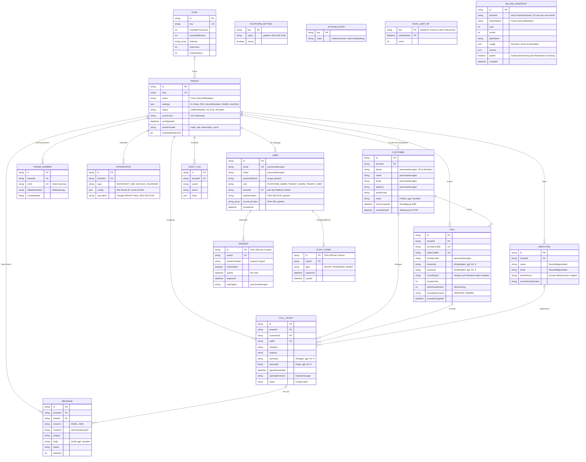

# Daten & Inhalte

> Phase 11 im Modus „Bestehende App“. Abgeleitet aus `prisma/schema.prisma`, `src/lib/services/retention.ts`, `src/lib/services/billing-close.ts`, `src/lib/services/customers.ts`, `src/lib/services/tenants.ts`, `src/lib/voice/*` und `src/lib/notify/*`. Stand: 2026-10-24 (Commit `33c0708`; Nachträge aus `48e363a` und `0e0efc5` sind mit Commit gekennzeichnet).
> Keine Rechtsberatung. Aussagen zu Anbieter-Standorten sind ohne Vertragsprüfung mit `[PRÜFEN]` markiert.

## Datenmodell

Jede fachliche Tabelle trägt `tenantId` (Besitzerfeld = Mandant). Zugriffe laufen nur über Abfragen mit `tenantId` aus der Sitzung bzw. aus der eigenen Anrufzeile (siehe `12-berechtigungen.md`). Plattform-Tabellen (`PlatformSetting`, `Plan`, `SystemState`, `RateLimitHit`) haben keinen Mandanten. `BillingSnapshot` (Monatsabschluss, Commit `48e363a`, Migration `20261024145906_billing_snapshot`) trägt `tenantId` **bewusst ohne Fremdschlüssel**, damit die festgeschriebenen Summen auch nach Löschung des Mandanten erhalten bleiben (GoBD, `docs/recht/loeschkonzept.md` §5).

**Einwilligungsfelder** (Commit `ae31147`, Migration `20261024144100_consent_fields`): `Customer.smsConsentAt`, `smsConsentSource`, `smsOptOutAt` (SMS-Einwilligung über `save_customer` nur für die verifizierte Nummer; Twilio-Fehler 21610 „STOP“ wird als Widerspruch vermerkt) und `Call.recordingConsent`, `recordingConsentAt` (Tool `recording_consent`, Variante C; bei „Nein“ oder ohne klare Antwort wird nach dem Gespräch der Aufnahme-Link entfernt und der Anruf beim Anbieter gelöscht, die Mitschrift bleibt).

**Nicht verwendet:** `prisma/postgres/schema.prisma` ist ein altes Einmandanten-Schema und nicht maßgeblich (OP-11-03).

## Datenklassifizierung

Klassen: **öffentlich** · **intern** (Geschäftsdaten ohne Personenbezug) · **personenbezogen** · **sensibel** (Inhaltsdaten, Beschäftigtendaten, Zugangs-Metadaten) · **besonders schützenswert möglich** (Art. 9 DSGVO kann vorkommen, z. B. „meine Mutter ist pflegebedürftig“, „Allergie gegen das Mittel“) · **geheim** (Zugangsdaten, Schlüssel).

| Objekt.Feld | Klasse | Pflicht? | Begründung | Aufbewahrung |
|---|---|---|---|---|
| Tenant.name, slug, industry, timezone | intern | ja | Mandantenzuordnung, Prompt-Variablen | bis Mandanten-Löschung |
| Tenant.settings (Begrüßung, FAQ, Preise, Zusatzanweisungen) | intern | ja | Prompt-Inhalt; vom Kunden gepflegt, deshalb Injektionsfläche (BD-01) | bis Mandanten-Löschung |
| Tenant.settings.emergency.transferNumber | personenbezogen | nein | Bereitschaftsnummer, oft Handy | bis Änderung |
| Tenant.avvVersion, avvSignedAt | intern | für ACTIVE ja | Nachweis Art. 28 DSGVO | bis Mandanten-Löschung |
| User.email, name | personenbezogen | E-Mail ja, Name nein | Anmeldung, Einladungen | bis Löschung des Zugangs bzw. Mandanten |
| User.passwordHash | geheim | nach Einladung ja | scrypt, nie ausgeben | bis Löschung |
| User.totpSecretEnc, recoveryCodes | geheim | nein | 2FA; verschlüsselt bzw. gehasht | bis 2FA-Abschaltung |
| User.failedLogins, lockedUntil, lastLoginAt | sensibel | ja | Missbrauchsschutz | laufend überschrieben |
| Session.id, userAgent, activeTenantId, authAt | sensibel | ja | Sitzungsverwaltung; ID nur als Hash | bis Ablauf, dann Löschung im täglichen Lauf |
| AuthToken.id | geheim | ja | nur SHA-256 gespeichert | 7 Tage nach Ablauf gelöscht |
| PhoneNumber.e164, fallbackNumber | intern / personenbezogen | e164 ja | Routing; Fallback kann Handynummer sein | bis Mandanten-Löschung |
| Integration.secretEnc | geheim | nein | Google-Refresh-Token, AES-256-GCM | bis Trennung (Token wird bei Google widerrufen) |
| Integration.config | intern | nein | Microsoft-Tenant-ID, Google-Kontoadresse | bis Trennung |
| Customer.phone | personenbezogen | ja | Wiedererkennung, Rückruf; Schlüssel je Mandant | bis DSGVO-Löschung oder Mandanten-Löschung (keine automatische Frist) |
| Customer.name, companyName, email, address, postalCode, customerType | personenbezogen | nein | Auftrag, Routing nach PLZ | wie Customer.phone |
| Customer.notes | sensibel / besonders schützenswert möglich | nein | Freitext des Büros | wie Customer.phone |
| Customer.smsConsentAt, smsConsentSource, smsOptOutAt | personenbezogen | nein | Nachweis Einwilligung/Widerspruch | wie Customer.phone |
| Employee.name, email, role, servicePostalCodes | sensibel (Beschäftigtendaten) | Name ja | Routing, Kalender, Benachrichtigung | Deaktivieren statt Löschen; bis Mandanten-Löschung |
| Employee.directPhone | sensibel (Beschäftigtendaten) | nein | Notfall-Durchstellung; wird der KI als `transferNumber` übergeben | wie Employee |
| Call.fromNumber, toNumber, startedAt, durationSec, twilioDurationSec | personenbezogen (Verkehrsdaten) | ja | Protokoll, Abrechnung | Zeile bleibt; Anrufe ohne Kunde und Vorgang werden nach Frist und Anbieter-Löschung entfernt – erst wenn ihr Monat festgeschrieben ist (`closeDueMonths`/`openPeriodStart`, Commit `48e363a`). Bei DSGVO-Löschung eines Anrufers wird die Zeile anonymisiert statt gelöscht (`fromNumber` = „gelöscht“, ohne Kunde, Transkript, Zusammenfassung), damit die Minuten des laufenden Monats abrechenbar bleiben |
| Call.transcript, summary | besonders schützenswert möglich | nein | Inhalt des Gesprächs | Frist je Mandant (Standard 365 Tage, 7–3650) |
| Call.recordingUrl | besonders schützenswert möglich (verweist auf Audio) | nein | Abspielen nur über `/api/calls/[id]/recording` | Frist je Mandant; Audio beim Anbieter wird vorher gelöscht |
| Call.recordingConsent, recordingConsentAt | personenbezogen | nein | Nachweis Einwilligung (Variante C, F-29) | wie Call |
| CallTicket.summary, category, urgency | besonders schützenswert möglich | Kategorie ja | Anliegen; Summary enthält die Beschreibung der KI | **keine automatische Frist** (siehe Lücke unten) |
| CallTicket.transcript | besonders schützenswert möglich | nein | Kopie des Anruf-Transkripts | Frist je Mandant |
| CallTicket.notes | sensibel / besonders schützenswert möglich | nein | Freitext des Büros | keine automatische Frist |
| CallTicket.appointmentStart/End, calendarEventId, emailDraftId | personenbezogen | nein | Termin, Verweis auf Kalender | bis Kunden- bzw. Mandanten-Löschung |
| Message.recipient | personenbezogen | ja | Versandprotokoll | bleibt nach der Frist als Versandnachweis; bei DSGVO-Löschung „gelöscht“ (Commit `48e363a`) |
| Message.subject | personenbezogen (Kategorie, Name) | nein | Betreff | Frist je Mandant – wird seit Commit `0e0efc5` mit dem Inhalt geleert; bei DSGVO-Löschung sofort |
| Message.body | sensibel / besonders schützenswert möglich | ja | E-Mail-/SMS-Inhalt mit Anliegen | Frist je Mandant (Inhalt wird geleert) |
| Message.meta | personenbezogen | nein | Absender, Antwortadresse, ICS für Wiederholung | wie Message; bei DSGVO-Löschung geleert |
| Message (ohne Mandant: Betreiber-Alarme) | intern / personenbezogen (Alarm-Empfänger) | – | Betriebsalarme | nach 90 Tagen gelöscht (Commit `48e363a`) |
| AuditLog.action, target, meta, userId | sensibel | ja | Nachvollziehbarkeit | 730 Tage |
| Plan.* | intern | ja | Paketgrenzen | bis Löschung durch Betreiber |
| BillingSnapshot.* (tenantName, planName, usage, invoice) | intern (Geschäftsdaten, keine Anruferdaten) | ja | festgeschriebene Monatssummen je Mandant (GoBD); Grundlage, damit Anrufdaten gelöscht werden dürfen | bleibt auch nach Mandanten-Löschung; Frist laut `docs/recht/loeschkonzept.md` §5 |
| PlatformSetting.value (secret = true) | geheim | nein | Anbieter-Schlüssel aus der Oberfläche, AES-256-GCM | bis Änderung |
| SystemState.* | intern | – | Lebenszeichen, Alarm-Entprellung | laufend überschrieben |
| RateLimitHit.key | personenbezogen (IP, Rufnummer, Konto-ID) | – | Missbrauchsschutz | abgelaufene Fenster im täglichen Lauf gelöscht |
| Server-Log (stdout, Docker json-file) | personenbezogen (maskierte Rufnummern, IDs) | – | Fehlersuche; keine Transkripte, Passwörter, Tokens | Rotation 5 × 20 MB (keine feste Frist, OP-20-15) |
| Backup (pg_dump, age-verschlüsselt) | enthält alle Klassen | – | Wiederherstellung | lokal 14 Tage, S3 30 Tage |

**Lücken bei der Datensparsamkeit (für 21-roadmap.md):**
- **Offen, Entscheidung nötig:** `CallTicket.summary` und `CallTicket.notes` können Gesundheitsangaben enthalten, werden von der Löschfrist aber nicht erfasst (`retention.ts` leert nur `CallTicket.transcript`). Kundenstammdaten haben gar keine Frist. Das ist fachlich gewollt („Vorgänge bleiben für die Geschäftsdokumentation“), muss aber im Löschkonzept begründet und je Mandant einstellbar sein.
- **Offen:** Kalendereinträge bei Outlook/Google enthalten Kategorie, Kundenname, Rufnummer, Adresse und die Zusammenfassung. Sie liegen beim Kunden und werden von der Löschfrist nicht erfasst (nur bei Terminabsage/-verschiebung entfernt); Test T-SEC-32 offen.
- **Behoben (Commit `0e0efc5`):** Die Löschfrist leert `Message.subject` zusammen mit dem Inhalt (`src/lib/services/retention.ts`); `recipient` bleibt als Versandnachweis.
- **Behoben (Commit `48e363a`):** Anrufe werden erst gelöscht, wenn ihr Monat als `BillingSnapshot` festgeschrieben ist; die DSGVO-Löschung eines Anrufers anonymisiert Anrufe und Nachrichten, statt sie zu löschen (`src/lib/services/customers.ts`); vor dem Löschen eines Mandanten wird die Schlussabrechnung festgeschrieben (`src/lib/services/tenants.ts`).

## Dateien

Nutzer laden keine Dateien hoch. Audio-Aufnahmen liegen **nur beim Anbieter** (Retell, Twilio, Vapi, ElevenLabs). Die App speichert nur den Verweis (`Call.recordingUrl`) und reicht das Audio nach Berechtigungsprüfung durch (`src/app/api/calls/[id]/recording/route.ts`, Host-Allowlist `RECORDING_HOSTS`). Es gibt keinen eigenen Dateispeicher. Das Firmenlogo ist nur eine URL (`Tenant.logoUrl`).

## Offline

Nicht vorgesehen. Portal und Telefon-KI brauchen eine Verbindung; bei Ausfall des Servers übernimmt das Ersatzziel bei Twilio (TwiML Bin, F-09).

## Zeitfelder

| Feld | Art (Zeitpunkt UTC / Wandzeit + Zeitzone / Kalendertag) | Regel |
|---|---|---|
| Alle `createdAt`, `updatedAt`, `startedAt`, `endedAt`, `expiresAt`, `usedAt`, `authAt`, `providerPurgedAt`, `nextAttemptAt` | Zeitpunkt UTC | Postgres-Typ `TIMESTAMP(3)` ohne Zeitzone (Prisma-Standard); die App schreibt und liest UTC. Manuelles SQL und Wiederherstellung immer in UTC (OP-11-04) |
| CallTicket.appointmentStart / appointmentEnd | Zeitpunkt UTC, erzeugt aus Wandzeit + `Tenant.timezone` | Slots werden in Ortszeit gerechnet (`src/lib/time.ts`), gespeichert als UTC; Tests zur Zeitumstellung in `tests/time.test.ts` |
| Tenant.settings.businessHours (Tage, Start, Ende) | Wandzeit + Zeitzone (`Tenant.timezone`, IANA) | gilt in Ortszeit des Mandanten, auch über die Zeitumstellung |
| Abrechnungsmonat, Tagesbudget | Kalendertag/-monat in Ortszeit | Monatsbeginn in Mandanten-Zeitzone, Tagesbudget in `Europe/Berlin` (`src/lib/cost-guard.ts`); Monatsabschluss (`BillingSnapshot.year/month`) ab dem 3. des Folgemonats in Ortszeit (`closeDueMonths`) |
| Tenant.avvSignedAt | Zeitpunkt UTC (fachlich Kalendertag) | nur Datum relevant |
| RateLimitHit.windowStart | Zeitpunkt UTC | Fensterbeginn, auf die Fensterlänge gerundet |

## Datenflüsse zu externen Diensten

| Daten | Dienst | Zweck | Ort (EU/USA) |
|---|---|---|---|
| Anrufernummer, angerufene Nummer, Audio des Gesprächs, CallSid, Aufnahme (Fallback/Mailbox), SMS-Inhalte und -Empfänger | Twilio (Telefonie, SMS) | Anrufannahme, Weiterleitung, Mailbox, SMS-Versand, Gesprächsende (StatusCallback), Abbruch überlanger Gespräche | USA, Unternehmen Twilio Inc. `[PRÜFEN]` Vertragspartner, Datenregion und DPF-Status [Q-020] |
| Audio, Transkript, Anrufernummer, Mandanten-Variablen (Firmenname, FAQ, Kundenname, Adresse, Kundentyp), Tool-Ergebnisse (Termine, Mitarbeitername, Notfallnummer) | Retell AI (Sprach-KI, Standard) | Gespräch führen, Transkript, Zusammenfassung | USA `[PRÜFEN]`; Unterauftragnehmer für LLM, STT, TTS offen (OP-16-02) |
| wie Retell | Vapi (Sprach-KI, wählbar je Mandant/Nummer) | wie Retell; zusätzlich `assistant-request` mit Variablen | USA, EU-Region nur mit Vapi-Premier-Tarif (`sip.eu.vapi.ai` laut Oberfläche) `[PRÜFEN]` |
| wie Retell | ElevenLabs (Sprach-KI, wählbar) | wie Retell; Post-Call-Webhook | USA, EU-Datenresidenz per Vertrag (`api.eu.residency.elevenlabs.io`) `[PRÜFEN]` |
| SIP-Weiterleitung mit Rufnummern und Audio | SIP-Anbieter (Bland, Synthflow, PolyAI) | nur vorbereitet; „nicht freigegeben“, keine Löschung per API | `[PRÜFEN]` je Anbieter |
| Termin (Kategorie, Kundenname, Rufnummer, Adresse, Zusammenfassung), Frei/Belegt-Abfrage, Mail-Entwürfe der Kundenbestätigung | Microsoft 365 / Graph (Kunden-Tenant) | Kalender der Mitarbeiter, Entwürfe | Region des Kunden-Tenants (meist EU); Zugriff über App-Berechtigung auf alle Postfächer des Kunden (OP-14-13) |
| Termin wie oben, Frei/Belegt, Google-Konto-E-Mail, Refresh-Token | Google Calendar API | Kalender der Mitarbeiter | USA/EU `[PRÜFEN]`; OAuth-Verifizierung offen (OP-15-06) |
| E-Mails an Anrufer, Mitarbeiter, Büro, Zugangslinks, Alarme (Empfänger, Betreff, Inhalt, ICS) | SMTP-Anbieter (z. B. IONOS) | Bestätigungen, Einladungen, Reset, Alarme | abhängig vom gewählten Anbieter; IONOS: Deutschland `[PRÜFEN]` |
| Komplette Datenbank, age-verschlüsselt | S3-Speicher (z. B. IONOS Object Storage) | externes Backup | Deutschland (Region laut `docs/betrieb.md`) `[PRÜFEN]` |
| alle Daten (Hosting) | IONOS VPS | Betrieb von App, Datenbank, Backups | Deutschland laut README `[PRÜFEN]` Rechenzentrum im Vertrag |
| Testdaten (keine echten Daten erlaubt) | Netlify (Testumgebung) | Oberflächen-Test | USA `[PRÜFEN]` |
| Erste 5 Zeichen des SHA-1-Hashes eines neuen Passworts | Have I Been Pwned (Range-API) | Leak-Prüfung (k-Anonymität) | `[PRÜFEN]`; kein Personenbezug |
| Alarmtexte (Titel, ohne Inhaltsdaten) | Alarm-Webhook (Slack/Teams/ntfy), Lebenszeichen-Dienst (z. B. healthchecks.io) | Überwachung | je Dienst `[PRÜFEN]` |
| Logo-URL | vom Kunden gewählter Host | Anzeige im Portal (Browser lädt direkt) | beliebig |

**Konsequenz:** Die VVT-, TOM- und AVV-Unterlagen in `docs/recht/` müssen alle Zeilen dieser Tabelle abdecken (OP-16-07, Agent C).

## Risikostufe

`docs/sicherheit.md` und E-017 führen **Stufe 2, Tendenz 3**. Nach `AGENTS.md` §5 gehören Daten nach Art. 9 DSGVO und „umfangreiche Daten über Dritte“ zu **Stufe 3**. Beides trifft hier zu: Anrufer sind Dritte, und Transkripte, Zusammenfassungen und Vorgangsnotizen können Gesundheitsangaben enthalten [Q-013]. **Empfehlung: Stufe 3** (im Zweifel die höhere Stufe). Die Folgen (ASVS Level 2, externe Fachprüfung vor dem Launch oder akzeptiertes Risiko) sind in `14-sicherheit.md` beschrieben. Die Festlegung selbst steht in `PROJECT_STATE.md` und E-017 und sollte auf Stufe 3 geändert werden.
