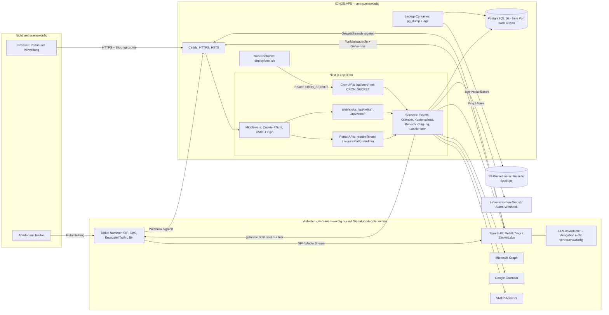
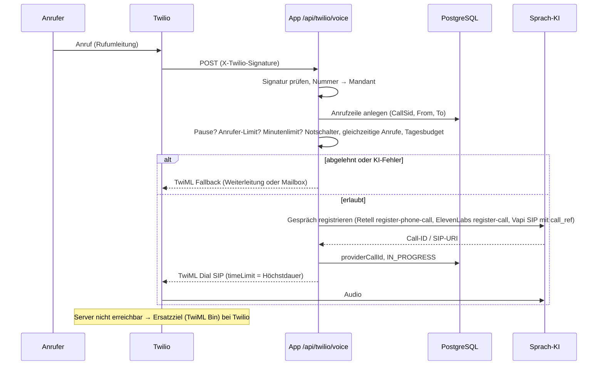
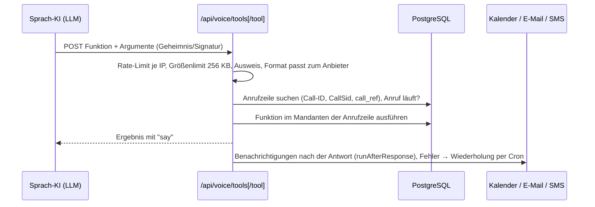

# Tech-Stack & Architektur

> Phase 13 im Modus „Bestehende App“: Der Stack steht fest und wird hier dokumentiert, nicht neu gewählt. Quellen: `package.json`, `Dockerfile`, `docker-compose.yml`, `deploy/*`, `netlify.toml`, `next.config.ts`, `src/middleware.ts`, `src/lib/**`. Stand: 2026-10-24.

## Entscheidung

| Bereich | Wahl | Begründung | Alternative |
|---|---|---|---|
| Frontend | Next.js 15 (App Router), React 19, Tailwind 3 | Ein Projekt für Portal und API, serverseitige Darstellung, kein separates Frontend-Deployment | getrenntes SPA + API (mehr Betrieb) |
| Backend | Next.js Route Handlers (Node.js 22), zod für Eingaben | Gleiche Sprache und Typen wie Frontend; Webhooks als Routen | eigener Node-/Go-Dienst |
| Datenbank | PostgreSQL 16 über Prisma 6 | Relationale Mandantendaten, Transaktionen, Migrationen; Rate-Limits sicherheitsrelevant ebenfalls in Postgres | Supabase (RLS fertig, aber Daten bei Drittanbieter) |
| Auth | Eigenbau: scrypt-Passwörter, Sitzungen in der DB (Cookie `ck_session`, SHA-256-ID), TOTP-2FA, Re-Auth | Volle Kontrolle, keine weiteren Auftragsverarbeiter | Login-Anbieter (Auth0, Clerk, Keycloak) – laut Regelwerk „besser“, hier bewusst nicht |
| Telefonie | Twilio (Nummern, SIP-Weiterleitung, SMS) | Programmierbare Nummern, TwiML, Signatur, Ersatzziel ohne eigenen Server | sipgate, Vonage |
| Sprach-KI | Retell (Standard), Vapi, ElevenLabs je Mandant/Nummer wählbar; SIP-Anbieter vorbereitet | Kein Anbieter-Lock-in, Preis/Qualität je Kunde | eigene STT/LLM/TTS-Kette (F-40, „nie“ für V1) |
| Kalender | intern (Postgres), Microsoft Graph (App-Berechtigung, Admin-Consent), Google Calendar (OAuth) | Kunden mit und ohne eigenen Kalender | CalDAV (F-35, später) |
| E-Mail | SMTP über nodemailer (beliebiger Anbieter) | Anbieter austauschbar | Transaktions-API (Postmark, Brevo) |
| Hosting Produktion | IONOS VPS, Docker Compose (app, db, caddy, cron, backup) | Hosting in Deutschland, feste Kosten, eine Instanz | Managed Container + Managed Postgres (teurer, mehr Anbieter) |
| Hosting Test | Netlify mit Netlify Database | Vorschau je Push ohne eigenen Server | Staging-VPS (fehlt, OP-20-07) |
| HTTPS / Proxy | Caddy 2 (Let's Encrypt, HSTS) | automatische Zertifikate, einfache Konfiguration | nginx + certbot |
| Backups | `pg_dump` → age → lokal + S3 (IONOS Object Storage), monatlicher Restore-Test | verschlüsselt außerhalb des Servers | Managed-Postgres-PITR |
| CI | GitHub Actions: Lint, Typprüfung, Tests gegen Postgres, `npm audit` (ab critical), Build, gitleaks, Docker-Build | Regel 10.2 | – |
| Coding-Tool | Claude Code | bisherige Entwicklung | – |
| Plattform / Veröffentlichung | Web-App (Portal), Telefon als zweiter Kanal; keine App-Stores | B2B-Portal, Zugang nur per Einladung | – |

## Plattform

| Punkt | Festlegung |
|---|---|
| Art der App (Q6) | Web-App (mandantenfähiges B2B-Portal) mit Telefon-Schnittstelle (Bot über Sprach-KI-Anbieter) |
| Zielsysteme (Q8, Q9, Q11, Q16) | aktuelle Desktop- und Mobil-Browser; Telefon: jedes Telefon über Rufumleitung auf eine Twilio-Nummer |
| Store/Veröffentlichungsweg (Q7) | keiner; Auslieferung per `git pull && docker compose up -d --build` auf dem VPS (OP-20-07: Image-Registry, Tags, Rollback fehlen) |
| Besonderheiten nach `guides/plattformen.md` | Webhook-Verfahren mit Signatur je Absender (Twilio HMAC-SHA1, Retell HMAC-SHA256 mit Zeitstempel, ElevenLabs HMAC, Geheimnis je Anbieter); Bot-Kanal ohne Konto des Anrufers → Identität nur über die von Twilio gemeldete Nummer |
| Phasen, die sich ändern/entfallen | Phase 15 ohne Login-Anbieter und ohne Zahlung (F-30 offen); keine Store-Themen in 17/23 |
| Architekturentscheidung | E-016 (ein IONOS-VPS mit Docker Compose, Netlify nur Test), E-007 (Ersatzziel als TwiML Bin bei Twilio), E-002 (Rate-Limits teils im Prozess), E-004 (keine RLS) |

## Architektur



**Vertrauensgrenzen:**
1. **Browser → App:** alles nicht vertrauenswürdig; jede Route prüft Sitzung, Rolle und Mandant selbst.
2. **Telefon-KI → App:** Die Anfrage ist authentisch (Geheimnis/Signatur), ihr **Inhalt** aber nicht: Argumente kommen vom LLM und sind vom Anrufer beeinflussbar (Prompt-Injection). Mandant und Anrufernummer kommen deshalb nur aus der eigenen Anrufzeile.
3. **App → Anbieter:** geheime Schlüssel nur serverseitig (`.env` oder verschlüsselt in `PlatformSetting`).
4. **Server → Backup-Speicher:** nur verschlüsselte Dumps verlassen den Server.

### Ablauf: eingehender Anruf



### Ablauf: Funktionsaufruf während des Gesprächs



### Ablauf: Gesprächsende und Löschung

```mermaid
sequenceDiagram
    participant T as Twilio
    participant V as Sprach-KI
    participant App as App
    participant DB as PostgreSQL
    T->>App: /api/twilio/status (Dauer, Ende)
    V->>App: /api/voice/events bzw. Vapi end-of-call-report bzw. ElevenLabs post_call
    App->>DB: Transkript, Zusammenfassung, Aufnahme-Verweis; Rückruf-Vorgang falls nötig
    Note over App: Cron /api/cron/calls schließt Anrufe ohne Ende-Ereignis
    Note over App: Cron /api/cron/retention (täglich): erst beim Anbieter löschen, dann lokal leeren
```

### Ablauf: Portal-Anfrage

Browser → Caddy → Middleware (ohne Cookie: `401` bzw. Login; schreibende Anfrage mit fremdem `Origin`: `403`) → Route → `requireTenant`/`requirePlatformAdmin` (Sitzung, 2FA, Rolle, Rate-Limit) → Abfrage mit `tenantId` → Antwort. Polling der Startseite über `src/lib/use-poll.ts`.

## Zeitgesteuerte Aufgaben

`deploy/cron.sh` im Container `cron` ruft die App über das interne Netz (`http://app:3000`) mit `Authorization: Bearer $CRON_SECRET`. Der Container läuft in UTC (Alpine-Standard) – „03 Uhr“ heißt 03:00 UTC.

| Takt | Endpunkt | Aufgabe |
|---|---|---|
| jede Minute | `/api/cron/notify` | fehlgeschlagene E-Mails/SMS erneut senden (bis 5 Versuche; Notfall nach 1, 2, 5, 10 min) |
| jede Minute | `/api/cron/calls` | Gespräche über der Höchstdauer bei Twilio beenden, Anrufe ohne Anbieter-Ende schließen |
| alle 5 min | `/api/cron/monitor` | Überwachung: Notfall-Alarme, gescheiterte Nachrichten, hängende Anrufe, Backup, Plattenplatz, Twilio-Konfiguration; Lebenszeichen-Ping |
| alle 15 min | `/api/cron/usage` | Kontingent-Warnungen 80 %/100 %, Tagesbudget |
| alle 15 min | `/api/cron/reminders` | Terminerinnerungen |
| täglich 03:00 UTC | `/api/cron/retention` | Löschfristen (Anbieter zuerst), abgelaufene Sitzungen/Tokens, Audit-Log > 730 Tage, Rate-Limit-Zähler, Umschlüsselung nach Schlüsselwechsel |
| – | `/api/cron/heartbeat` | Lebenszeichen fremder Jobs (Backup-Container meldet Ergebnis) |
| auf Anforderung | `/api/cron/rekey` | Umschlüsselung nach `APP_ENCRYPTION_KEY`-Wechsel (Commit `fa49bd4`) |
| täglich ~02:00 UTC | Container `backup` | `deploy/backup-once.sh`: Dump, age, lokal 14 Tage, S3 30 Tage, Meldung an `/api/cron/heartbeat` |
| am 1. des Monats ~04:00 UTC | Container `backup` | `deploy/restore-test.sh`: Wiederherstellung in Wegwerf-DB |

Fällt der `cron`-Container aus, laufen keine Wiederholungen, keine Höchstdauer-Durchsetzung über die API und keine Löschfristen. Die Überwachung selbst läuft auch über Cron; deshalb ist der **externe** Lebenszeichen-Dienst (`HEALTHCHECK_PING_URL`) Pflicht.

## Umgebungen

| Umgebung | Zweck | Datenbank | Schlüssel |
|---|---|---|---|
| Lokal | Entwicklung, Tests (`npm test`, Integrationstest mit Postgres) | lokales Postgres | eigene Testwerte; ohne `APP_ENCRYPTION_KEY` Entwicklungsschlüssel (nur außerhalb Produktion) |
| CI (GitHub Actions) | Lint, Typen, Tests, Audit, Build, gitleaks, Docker-Build | Postgres-Dienst im Workflow | keine echten Schlüssel |
| Test (Netlify) | Oberfläche ausprobieren, Demo-Mandant (`DEMO_SEED`) | Netlify Database (Migrationen als Kopie, `tests/netlify-migrations.test.ts`) | eigene, nicht produktive Werte; **keine echten Kundendaten, keine echten Anrufe**. Abweichungen: mehrere Instanzen (Prozess-Rate-Limits unzuverlässig), kein Cron (keine Löschfristen), Variablen im Netlify-Dashboard sichtbar (OP-13-04, OP-20-13) |
| Staging | Test mit Test-Telefonnummer vor jedem Release | fehlt (OP-20-07) | – |
| Produktion (IONOS VPS) | echte Kunden | Postgres im Container, Volume `db-data`, kein Port nach außen | `.env` auf dem Server (Rechte 600 empfohlen) und verschlüsselt in `PlatformSetting`; Werte aus der Oberfläche überlagern `.env` |

## Bewertungsmatrix

Rückblickend dokumentiert (die Entscheidung ist gefallen). Gewicht 1–3, Note 1–5.

| Kriterium | Gewicht | IONOS VPS + Compose | Managed (z. B. Container-Dienst + Managed Postgres, EU) | Netlify + Netlify Database |
|---|---|---|---|---|
| Datenstandort Deutschland/EU | 3 | 5 | 4 | 2 |
| Laufende Kosten | 2 | 5 | 3 | 4 |
| Betriebsaufwand (Updates, Härtung, Backups) | 2 | 2 | 4 | 5 |
| Verfügbarkeit (Single Point of Failure) | 3 | 2 (ein Server; Ersatzziel bei Twilio federt Anrufe ab) | 4 | 4 |
| Cron, lange Webhooks, Prozess-Zustand | 2 | 5 | 4 | 2 |
| Wenige Auftragsverarbeiter | 2 | 5 | 3 | 3 |
| **Summe (gewichtet)** | | **54** | **54** | **47** |

Gleichstand zwischen VPS und Managed: Der VPS gewinnt bei Kosten und Datenstandort, verliert bei Verfügbarkeit und Betriebsaufwand. Für die ersten Pilotkunden vertretbar, wenn Ersatzziel, externe Backups, Überwachung und Härtung nachgewiesen sind. Neu bewerten, wenn eine SLA-Zusage über die Verfügbarkeit eines Einzelservers hinaus nötig wird (siehe `18-qualitaetsziele.md`).

## Kosten-Schätzung

Siehe `17-kosten.md` (Agent C). Die Einkaufspreise im Code (`COST_TELEPHONY_CENTS_PER_MIN=1.5`, `COST_VOICE_CENTS_PER_MIN=10`, `COST_SMS_CENTS=8`) sind unbelegte Annahmen (OP-17-01).

## Risiken & Lock-in

- **Ein Server:** Ausfall des VPS = kein Portal, keine KI. Anrufe gehen über das Ersatzziel bei Twilio an die Fallback-Nummer (F-09); die Einrichtung je Nummer ist noch offen. Wiederanlauf: neuer VPS + Restore (Ziele in `18-qualitaetsziele.md`).
- **Twilio** ist zentral (Nummern, SIP, SMS, Ersatzziel). Ein Wechsel bedeutet Portierung der Nummern und neue Webhooks. Mittel.
- **Sprach-KI-Anbieter** sind austauschbar (Abstraktion in `src/lib/voice/handoff.ts`, `payload.ts`, `events.ts`), aber Prompt und Tools werden je Anbieter von Hand gepflegt (F-37). Formate sind nur aus der Doku umgesetzt, nicht mit echten Konten belegt (OP-15-01).
- **Eigenbau-Auth** statt Login-Anbieter: mehr eigene Verantwortung (Passwort-Reset, 2FA, Sitzungen). Gut umgesetzt, aber nur auf Service-Ebene getestet (HTTP-Tests offen).
- **Prisma 6 / Next 15:** bekannte hohe Schwachstellen, Behebung nur per Major-Update (E-003).
- **Plattformfallen für Phase 14:** Prozess-Speicher bei mehreren Instanzen (Netlify), Werte aus der Oberfläche überlagern `.env` (ein kompromittierter Plattform-Admin kann Anbieter-Schlüssel und Webhook-Geheimnisse ändern), `APP_ENCRYPTION_KEY` schützt alle Geheimnisse in der DB.
