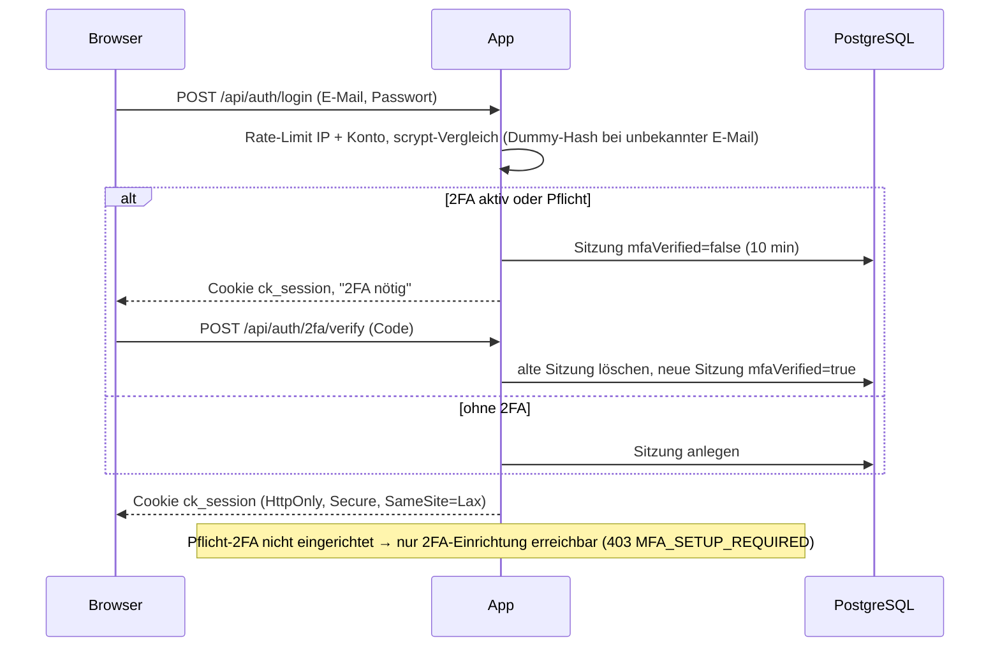

# Login, Zahlung & Integrationen

> Phase 15 im Modus „Bestehende App“. Quellen: `src/app/api/auth/**`, `src/lib/auth/**`, `src/lib/voice/**`, `src/lib/graph.ts`, `src/lib/google.ts`, `src/lib/notify/**`, `src/lib/platform/registry.ts`, `deploy/backup*.sh`. Stand: 2026-10-24.
> **Wichtigster offener Punkt:** Keine einzige Anbieter-Anbindung ist mit einem echten Konto Ende zu Ende belegt. Alle Formate (Signaturen, Payloads, Lösch-APIs) sind nach Anbieter-Doku umgesetzt und nur mit synthetischen Payloads getestet (`tests/payload.test.ts`, `tests/providers.test.ts`, B1 BF-17, OP-15-01). Nachweis über `docs/testanrufe.md` und echte Payloads als Fixtures unter `tests/fixtures/<anbieter>/`.

## Login

- Methoden: E-Mail + Passwort, zweiter Faktor TOTP (Authenticator-App) mit Wiederherstellungscodes; Re-Auth (Passwort, bei aktiver 2FA zusätzlich Code) für sensible Aktionen.
- Anbieter: keiner – Eigenbau (`src/lib/auth/*`). Keine Selbstregistrierung: Zugänge nur per Einladung durch Kunden-Admin oder Plattform-Admin; erster Plattform-Admin per `SETUP_TOKEN`.
- Werte (Laufzeiten, Limits): `14-sicherheit.md`.

## Zahlung

- Modell: Monatspaket mit Freiminuten, Überminuten (`CHARGE`) oder Sperre (`BLOCK`), SMS-Kontingent, Einrichtungsgebühr (`Plan`, `src/lib/billing.ts`).
- Anbieter: **keiner**. Es gibt nur Vorschau und CSV für den Betreiber (`/api/admin/billing`). Echte Rechnungen, Zahlung (SEPA/Karte) und Mahnwesen fehlen (F-30, OP-15-07).
- Ablauf: Freischaltung von Paketfunktionen erfolgt heute ausschließlich durch den Plattform-Admin (Paket am Mandanten) und wird serverseitig geprüft (`hasFeature`, `assertUserSlot`, Nummernlimit). Bei Einführung eines Zahlungsanbieters: Freischaltung nur nach bestätigtem Zahlungs-Webhook, nie aus Client-Parametern (Regel 8.1/8.2, T-SEC-16).
- Abrechnungsgrundlage: Gesprächsdauer laut Twilio-StatusCallback (`twilioDurationSec`), Rückfall auf Anbieter-Dauer.

## Dienste

| Dienst | Anbieter | Zweck | Daten | Ort | Kosten / Gratis-Grenze | Schlüssel geheim? | Ausfallfolge |
|---|---|---|---|---|---|---|---|
| Telefonie, SMS | Twilio | Nummern, Anrufannahme, SIP zur Sprach-KI, Mailbox, SMS, Ersatzziel | Rufnummern, Audio, SMS-Inhalt | USA `[PRÜFEN]` | nach Verbrauch, siehe `17-kosten.md` | ja (`TWILIO_AUTH_TOKEN`) | ohne Twilio keine Anrufe; App-Ausfall → Ersatzziel (TwiML Bin) |
| Sprach-KI | Retell AI | Standard-Agent für alle Mandanten | Audio, Transkript, Kundenvariablen | USA `[PRÜFEN]` | nach Minuten | ja (`RETELL_API_KEY`, `VOICE_TOOL_SECRET_RETELL`) | Übergabe scheitert → Fallback-Nummer/Mailbox, Rückruf-Vorgang |
| Sprach-KI | Vapi | alternativ je Mandant/Nummer | wie Retell | USA, EU nur mit Premier `[PRÜFEN]` | nach Minuten | ja (`VAPI_API_KEY`, `VOICE_TOOL_SECRET_VAPI`) | wie Retell; `assistant-request` mit Fehlertext |
| Sprach-KI | ElevenLabs | alternativ je Mandant/Nummer | wie Retell | USA, EU-Residency per Vertrag `[PRÜFEN]` | nach Minuten | ja (`ELEVENLABS_API_KEY`, `ELEVENLABS_WEBHOOK_SECRET`, `VOICE_TOOL_SECRET_ELEVENLABS`) | wie Retell |
| Sprach-KI | SIP-Anbieter (Bland, Synthflow, PolyAI) | vorbereitet, „nicht freigegeben“ | wie Retell | `[PRÜFEN]` | – | ja (`VOICE_TOOL_SECRET_SIP`, `SIP_<ID>_API_KEY`) | – |
| Kalender, Entwürfe | Microsoft 365 (Graph) | Frei/Belegt, Termine, Mail-Entwürfe | Termin mit Kunde, Adresse, Zusammenfassung | Kunden-Tenant | in Lizenz des Kunden | ja (`MS_CLIENT_SECRET`) | Slots aus internem Kalender, Warnung `calendarWarning`; Fehler im Vorgang sichtbar |
| Kalender | Google Calendar | Frei/Belegt, Termine | wie Microsoft | `[PRÜFEN]` | kostenlos bis Kontingent `[PRÜFEN]` | ja (`GOOGLE_CLIENT_SECRET`, Refresh-Token verschlüsselt) | wie Microsoft |
| E-Mail | SMTP (z. B. IONOS) | Bestätigungen, Technikerinfo, Einladungen, Reset, Alarme | Empfänger, Inhalt | je Anbieter | je Tarif | ja (`SMTP_PASS`) | Nachricht `FAILED` → Wiederholung per Cron (5 Versuche), Alarm bei Notfall-Alarmen |
| Backup-Speicher | S3-kompatibel (z. B. IONOS Object Storage) | externe Backups | verschlüsselte Dumps | Deutschland `[PRÜFEN]` | nach Speicher | ja (`BACKUP_S3_*`) | Backup gilt als fehlgeschlagen → kritischer Alarm; lokaler Dump bleibt |
| Leak-Prüfung | Have I Been Pwned [Q-021] | Passwort gegen Lecks | 5 Zeichen Hash-Präfix | `[PRÜFEN]` | kostenlos `[PRÜFEN]` | nein | fail-open (Passwort wird angenommen) |
| Lebenszeichen, Alarm-Webhook | z. B. healthchecks.io, Slack/Teams/ntfy | externe Überwachung | Alarmtitel | je Dienst | je Tarif | ja (URL ist Zugang) | kein externer Alarm bei Serverausfall |
| Hosting | IONOS VPS | Produktion | alle | Deutschland `[PRÜFEN]` | fest | – | Totalausfall → Ersatzziel bei Twilio, Restore auf neuem VPS |
| Testumgebung | Netlify | Oberflächen-Test | nur Testdaten | `[PRÜFEN]` | Tarif | ja (eigene Testwerte) | keine Auswirkung auf Produktion |

## Twilio

| Punkt | Festlegung |
|---|---|
| Ausgehende Authentifizierung | Basic Auth mit `TWILIO_ACCOUNT_SID` + `TWILIO_AUTH_TOKEN` (SMS, Call beenden, Aufnahme/Call löschen, Nummernprüfung) |
| Webhooks | `/api/twilio/voice` (A call comes in), `/api/twilio/status` (StatusCallback: Ende, Dauer [Q-007], Abrechnungsgrundlage E-006), `/api/twilio/fallback` (Fallback innerhalb der App), `/api/twilio/recording?call=<id>` (Mailbox) – alle mit `X-Twilio-Signature` (HMAC-SHA1 über `PUBLIC_BASE_URL` + Pfad + sortierte Parameter); in Produktion nicht abschaltbar |
| Ersatzziel | „Primary handler fails“ je Nummer als TwiML Bin bei Twilio [Q-006] (E-007) (nicht auf dem eigenen Server); die Überwachung prüft per API, dass es gesetzt ist und nicht auf die eigene Domain zeigt (`src/lib/voice/twilio-config.ts`) |
| Konfiguration der Nummern | manuell in der Twilio-Konsole; App prüft nur (F-32 offen) |
| Fehlerverhalten | Signatur falsch → `403`; unbekannte Nummer → Fallback-TwiML; KI-Übergabe scheitert → Fallback-Nummer bzw. Mailbox + Rückruf-Vorgang; Höchstdauer per `timeLimit` und Cron-Abbruch |
| Löschung | Aufnahme und Call-Protokoll per API bei Löschfrist, DSGVO-Löschung und Mandanten-Löschung (`purgeCallAtProviders`) |
| Offen | Geo-Permissions für Anrufe/SMS auf Zielländer beschränken, Budget-Alarm im Konto `[PRÜFEN]` (nicht prüfbar); Secondary Auth Token für Rotation |
| Verifiziert mit echtem Konto | **nein** (Signaturbeispiel aus der Doku in `tests/security.test.ts`) |

## Retell AI

| Punkt | Festlegung |
|---|---|
| Ausgehende Authentifizierung | `Authorization: Bearer RETELL_API_KEY` (`register-phone-call`, `delete-call`) |
| Webhooks | Funktionen: `/api/voice/tools/<name>` bzw. `/api/voice/tools`; Ereignisse: `/api/voice/events` (`call_started`, `call_ended`, `call_analyzed`) |
| Absender-Prüfung | `x-retell-signature` = `v=<ts>,d=<HMAC-SHA256(body+ts)>` mit `RETELL_API_KEY`, ±5 min; **zusätzlich** wird die alte Form ohne Zeitstempel angenommen (Replay möglich, `src/lib/security.ts:112`); alternativ `VOICE_TOOL_SECRET_RETELL` als Header |
| Anrufbindung | Call-ID aus `register-phone-call` ist an der Anrufzeile gespeichert; Funktionen nur für laufende Anrufe. Rückgriff auf die angerufene Nummer ohne „läuft“-Prüfung, wenn keine Zeile passt (`src/lib/voice/context.ts:171`) |
| Fehlerverhalten | `register-phone-call` mit Timeout; Fehler → Fallback. Funktion ohne zugeordneten Anruf → Antwort „Anliegen notieren, Rückruf anbieten“ |
| Aufzeichnung | Agent ohne Speicherung (`RETELL_AGENT_ID_NO_STORAGE`) für Mandanten ohne Aufzeichnung; fehlt er, wird aufgezeichnet **und angesagt** |
| Löschung | `DELETE /v2/delete-call/{id}` vor dem lokalen Leeren [Q-008] |
| Agent-Einrichtung | Prompt (`voice-agent/system-prompt.md`) und Tools (`voice-agent/tools.json`) per Copy-Paste; Konsistenztest `tests/voice-auth.test.ts` („voice-agent/tools.json“); Provisionierung per API offen (F-37) |
| Offen | DPA, TIA, Unterauftragnehmer (OP-16-02); `transfer_call` beim Anbieter auf feste Ziele beschränken `[PRÜFEN]` |
| Verifiziert mit echtem Konto | **nein** (Signaturformat v=…,d=… unbestätigt) |

## Vapi

| Punkt | Festlegung |
|---|---|
| Ausgehende Authentifizierung | `Authorization: Bearer VAPI_API_KEY` (SIP-Nummer anlegen, Call löschen) |
| Webhooks | eine Server-URL `/api/voice/vapi` für `assistant-request` (Antwort muss < 7,5 s kommen), `tool-calls`, `end-of-call-report` |
| Absender-Prüfung | `x-vapi-secret` = `VOICE_TOOL_SECRET_VAPI`; nur Vapi-Format erlaubt |
| Anrufbindung | Weiterleitung von Twilio per SIP `sip:ck<nummer>@sip.vapi.ai` mit eigener Call-Referenz (`x-call_ref`); `assistant-request` ordnet über angerufene Nummer bzw. Call-Referenz zu und verknüpft die Vapi-Call-ID |
| Fehlerverhalten | `assistant-request` mit Fehler → Ansage „Assistent nicht erreichbar“; unbekannte Nummer → „Rufnummer nicht vergeben“ |
| Löschung | `DELETE https://api.vapi.ai/call/{id}` – nutzt **nicht** `VAPI_API_BASE` (`src/lib/voice/providers.ts:36`), bei EU-Region prüfen |
| Verifiziert mit echtem Konto | **nein** (Durchreichung von `x-call_ref` über Twilio-SIP unbestätigt) |

## ElevenLabs

| Punkt | Festlegung |
|---|---|
| Ausgehende Authentifizierung | `xi-api-key: ELEVENLABS_API_KEY` (`/v1/convai/twilio/register-call`, Löschung) |
| Webhooks | Funktionen als Webhook-Tools an `/api/voice/tools/<name>`; Post-Call-Webhook an `/api/voice/events/elevenlabs` |
| Absender-Prüfung | Funktionen: `VOICE_TOOL_SECRET_ELEVENLABS`; Post-Call: `ElevenLabs-Signature` `t=…,v0=…` (HMAC-SHA256, ±30 min) mit `ELEVENLABS_WEBHOOK_SECRET` |
| Anrufbindung | Kennungen (`call_sid`, `call_ref`) stehen im selben Body wie die KI-Argumente → **nur** eine selbst angelegte Anrufzeile zählt, kein Rückgriff auf die Nummer (`requireCall`) |
| Fehlerverhalten | `register-call` mit 5 s Timeout; Fehler → Fallback. Höchstdauer nur über Cron-Abbruch bei Twilio (kein `timeLimit`) |
| Löschung | `DELETE {ELEVENLABS_API_BASE}/v1/convai/conversations/{id}` |
| Verifiziert mit echtem Konto | **nein** (Webhook-Tool-Hülle und Signatur nur aus Doku) |

## SIP-Anbieter (Bland, Synthflow, PolyAI)

Nur vorbereitet (`SIP_<ID>_URI`, `VOICE_TOOL_SECRET_SIP`), in der Oberfläche „nicht freigegeben“ (E-023). Keine Löschung beim Anbieter per API (`purgeOtherProvider` gibt „ok“ zurück, ohne zu löschen), Formate nicht verifiziert. Bis zum Nachweis nicht für echte Kunden freigeben (OP-15-05).

## Microsoft 365 (Graph)

| Punkt | Festlegung |
|---|---|
| Authentifizierung | eine mehrinstanzfähige Entra-App der Plattform (`MS_CLIENT_ID`/`MS_CLIENT_SECRET`), Client-Credentials je Kunden-Tenant; Kunde erteilt Admin-Consent |
| Rücksprung | `/api/integrations/microsoft/callback` prüft Sitzung, Mandant und Nonce (`state`) |
| Rechte | Anwendungsberechtigungen für Kalender und Mail gelten für **alle Postfächer** des Kunden-Tenants; Application Access Policy empfehlen (OP-14-13) |
| Fehlerverhalten | Timeout 8 s; Fehler → interner Kalender, Fehlermeldung im Vorgang, Status `ERROR` |
| Löschung / Trennung | Trennen entfernt die Verbindung; der Kunde entzieht den Consent in Entra; bestehende Kalendereinträge bleiben beim Kunden |
| Verifiziert mit echtem Konto | **nein**; Publisher Verification offen (OP-15-06) [Q-024] |

## Google Calendar

| Punkt | Festlegung |
|---|---|
| Authentifizierung | OAuth 2.0 (Webanwendung), Scopes `openid`, `email`, `calendar.events`, `calendar.freebusy`; Refresh-Token AES-256-GCM in `Integration.secretEnc` |
| Rücksprung | `/api/integrations/google/callback` prüft Sitzung, Mandant und Nonce |
| Fehlerverhalten | Timeout 8 s; wie Microsoft |
| Löschung / Trennung | Trennen widerruft das Token bei Google und löscht es lokal |
| Verifiziert mit echtem Konto | **nein**; OAuth-Verifizierung für den sensiblen Scope `calendar.events` offen (OP-15-06) [Q-023] |

## SMTP und SMS-Zustellung

| Punkt | Festlegung |
|---|---|
| Ablauf | Nachricht wird zuerst als `Message` (QUEUED) gespeichert, dann versendet; aus dem Gesprächspfad erst nach der Antwort an die KI (`runAfterResponse`) |
| Wiederholung | `/api/cron/notify` jede Minute, bis 5 Versuche; Notfall nach 1, 2, 5, 10 min, sonst 2, 10, 30, 120 min; hängende QUEUED nach 10 min als fehlgeschlagen |
| Fehlerverhalten | ohne konfigurierten Dienst `SKIPPED` mit Protokoll; Alarm bei nicht zugestellten Notfall-Alarmen |
| Offen | SPF/DKIM/DMARC nachweisen (OP-15-09); SMS-Ziele auf verifizierte bzw. erlaubte Länder begrenzen (BD-03); Opt-out über Twilio „STOP“ (`smsOptOutAt`, Commit `ae31147`) – Bestätigungen und Erinnerungen per SMS beachten ihn |
| Verifiziert | **nein** (nur Integrationstest mit simuliertem Versand) |

## Backup-Speicher (S3)

| Punkt | Festlegung |
|---|---|
| Authentifizierung | Zugangsschlüssel nur für den Bucket (`BACKUP_S3_ACCESS_KEY`/`_SECRET_KEY`), rclone |
| Ablauf | `pg_dump` → age (öffentlicher Schlüssel) → lokal 14 Tage → Bucket 30 Tage → Meldung an `/api/cron/heartbeat` |
| Fehlerverhalten | fehlender Schlüssel oder Bucket → Lauf fehlgeschlagen, kritischer Alarm |
| Empfehlung | Versionierung bzw. Object Lock aktivieren |
| Verifiziert | **nein** (Produktionsserver fehlt; Restore-Test-Skript vorhanden) |

## Verifizierungsstatus (Zusammenfassung)

| Integration | Synthetischer Test | Echtes Konto | Löschung belegt | Nachweis-Weg |
|---|---|---|---|---|
| Twilio | ja | nein | nein | `docs/testanrufe.md` Szenarien 1–20 |
| Retell | ja | nein | nein | Szenarien 1–12, 20 |
| Vapi | ja | nein | nein | Szenarien 1–12 |
| ElevenLabs | ja | nein | nein | Szenarien 1–12 |
| SIP-Anbieter | nein | nein | keine Lösch-API | gesperrt lassen |
| Microsoft 365 | nein | nein | – | Test-Tenant, Szenario 2 |
| Google Calendar | nein | nein | – | Testkonto, Szenario 2 |
| SMTP / SMS | Integrationstest (simuliert) | nein | – | Szenarien 2, 7 |
| S3-Backup | nein | nein | – | `deploy/restore-test.sh` mit Datum |
