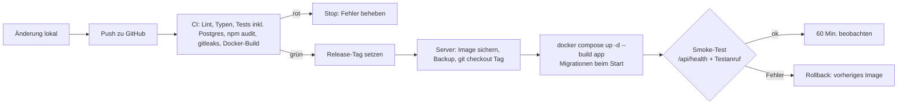

# Betrieb

> Phase 20 (`phases/20-betrieb.md`) für die bestehende App, Stand 2026-10-24. **Kurzfassung mit Verweisen**: Das ausführliche Betriebshandbuch ist [`docs/betrieb.md`](../betrieb.md) (Server-Härtung, Dienste, Backups, Ersatzziel bei Twilio, Überwachung, Gesprächsende, Kostenschutz, Wiederholung von Nachrichten). Dieses Dokument ordnet es den Punkten der Phase zu und nennt, was fehlt.
> Zugehörige Dokumente (statt `20-…`-Kopien im Projektordner liegen sie im App-Repository): Release-Checkliste [`docs/release-checkliste.md`](../release-checkliste.md) · Support-Playbook [`docs/support-playbook.md`](../support-playbook.md) · Incident-Plan [`docs/recht/incident-plan.md`](../recht/incident-plan.md) · Betreiberkonten/2FA [`docs/betreiber-konten.md`](../betreiber-konten.md) · Kosten [`17-kosten.md`](17-kosten.md).

## Deployment

Heute gibt es **keine Vorschau-Umgebung mit echter Telefonie**; die Netlify-Testumgebung zeigt nur die Oberfläche (README). Gebaut wird auf dem Produktionsserver (OP-20-07).

## Monitoring & Alarme

| Was | Werkzeug | Alarm an |
|---|---|---|
| Notfall-Alarm nicht zugestellt, Backup/Wiederherstellungstest fehlt oder fehlgeschlagen, Speicher < 5 % | `/api/cron/monitor` alle 5 Min. (`docs/betrieb.md`) | `ALERT_EMAIL`, kritisch zusätzlich `ALERT_SMS`, `ALERT_WEBHOOK_URL` |
| Nachrichten nicht zustellbar, hängende Anrufe, Twilio-Nummern ohne Ersatzziel/Status-URL, fehlende Anbieter-Ereignisse | wie oben (Warnung) | `ALERT_EMAIL` |
| Kontingent 80/100/200 %, Tagesbudget 80/100 % | `/api/cron/usage` alle 15 Min. | Kunden-Admins bzw. Betreiber |
| Kompletter Serverausfall | externer Lebenszeichen-Dienst (`HEALTHCHECK_PING_URL`) + Uptime-Check auf `/api/health` | E-Mail/SMS/App des Dienstes ☐ einrichten |
| Kosten bei Anbietern | Usage-/Budget-Alarme bei Twilio, Retell, Vapi, ElevenLabs | ☐ einrichten (`17-kosten.md`) |
| Fehler-Tracking (Exceptions) | nicht vorhanden | offen, nur ohne personenbezogene Daten und mit EU-Region |

## Umgebungen

| Umgebung | Zweck | Datenbank | Schlüssel | Zugriff | Adresse |
|---|---|---|---|---|---|
| Lokal | Entwicklung | `docker-compose.dev.yml`, Seed-Daten | Entwicklungswerte, `REQUIRE_PLATFORM_ADMIN_2FA` abschaltbar | Entwickler | `http://localhost:3000` |
| Test (Netlify) | Oberfläche ausprobieren, keine echten Anrufe | Netlify Database, Testdaten (`DEMO_SEED` nur hier) | eigene Testwerte | Betreiber | Netlify-URL des Branches |
| Staging mit Test-Rufnummer | Release vorab mit echter Telefonie prüfen | – | – | – | **fehlt** (OP-20-07) |
| Produktion | Kunden | Postgres im Compose-Netz, kein Port nach außen | `.env` (Rechte 600), Tresorkopie | Admin `betrieb` per SSH-Schlüssel, 2FA in allen Konten | `https://<DOMAIN>` |

## Pipeline (CI/CD)

| Stufe | Werkzeug | Bei Fehler | Nachweis |
|---|---|---|---|
| Installation aus Lockfile | `npm ci` (`.github/workflows/ci.yml`) | Stopp | CI-Lauf |
| Typprüfung | `npm run typecheck` | Stopp | CI-Lauf |
| Tests inkl. Sicherheitstests | `npm test` mit Postgres-Service (`TEST_DATABASE_URL`) | Stopp | CI-Lauf |
| Abhängigkeitsprüfung | `npm audit --omit=dev --audit-level=critical` (E-003) | Stopp ab „critical“ | CI-Lauf |
| Secret-Scan | gitleaks (Job `secrets`) | Stopp + Schlüssel widerrufen | CI-Lauf |
| Build | `docker build` (Job `docker`) | Stopp | CI-Lauf |
| Vorschau-Deployment | – | – | fehlt (Staging) |
| Freigabe | Release-Checkliste, Inhaber | – | `docs/releases/<version>.md` |
| Produktion + Smoke-Test | manuell auf dem Server, `docs/release-checkliste.md` B–C | Rollback | Checkliste |

Wer darf veröffentlichen: nur der Inhaber/Betreiber nach grüner CI. Schutz von `main`: **offen** (laut Prüfung: Repository öffentlich, kein Branch-Schutz, Standard-Branch ist ein Feature-Branch).

## Geheimnisse pro Umgebung (ohne Werte)

Vollständige Liste in `.env.example`; Kurzfassung der Pflichtwerte:

| Geheimnis | Zweck | Lokal | Test | Produktion | Wo gespeichert | Wer hat Zugriff | Zuletzt erneuert |
|---|---|---|---|---|---|---|---|
| `APP_ENCRYPTION_KEY` (+ `APP_ENCRYPTION_KEYS_OLD` beim Wechsel) | verschlüsselt 2FA-Geheimnisse, Anbieter-Schlüssel aus der Oberfläche (`PlatformSetting`), Google-Refresh-Tokens | Entwicklungsschlüssel | eigener | eigener | `.env` + Tresor | Betreiber | |
| `CRON_SECRET`, `SETUP_TOKEN` | Cron-Endpunkte, Ersteinrichtung | ja | ja | ja | `.env` | Betreiber | |
| `VOICE_TOOL_SECRET_<ANBIETER>` | Tool-/Ereignis-Aufrufe der Sprach-KI | optional | optional | je genutztem Anbieter | `.env` bzw. Oberfläche | Betreiber | |
| `TWILIO_AUTH_TOKEN`, `RETELL_API_KEY`, `VAPI_API_KEY`, `ELEVENLABS_API_KEY`, `MS_CLIENT_SECRET`, `GOOGLE_CLIENT_SECRET`, `SMTP_PASS` | Anbieterzugänge | – | – | ja | `.env` oder Verwaltung → Plattform (verschlüsselt) | Betreiber | |
| `POSTGRES_PASSWORD` | Datenbank | Dev-Wert | Netlify | ja | `.env` | Betreiber | |
| `BACKUP_S3_*`, `secrets/backup-age.key` | Backups | – | – | ja | `.env`, Schlüsseldatei + Tresor | Betreiber | |

## Datenbank-Migrationen

- Nur über `prisma/migrations/`; der Container wendet sie beim Start an (`prisma migrate deploy` im `Dockerfile`). Nie manuell in Produktion.
- **Backup vor jeder Migration** (`docker compose exec backup sh /deploy/backup-once.sh`, Release-Checkliste B2).
- Expand/contract: Spalten nur hinzufügen; Entfernen/Umbenennen erst im übernächsten Release, damit ein Rollback auf das alte Image mit dem neuen Schema läuft.

## Rollback

| Art der Änderung | Rollback-Weg | Bedingung |
|---|---|---|
| Code ohne Migration bzw. mit expand-Migration | gesichertes Image `call-ki-app:rollback-<commit>` starten (`--no-build`) | Normalfall |
| Nicht rückwärtskompatible Migration | Backup einspielen, altes Image, Löschungen erneut anwenden | nur wenn das alte Image nicht startet |
| Sprach-KI-Prompt/Tools | Agent beim Anbieter auf vorherige Version | gleichzeitig mit dem Code |

- Rollback-Kriterium: Smoke-Test (`/api/health` oder Testanruf) schlägt fehl, Anrufe kommen nicht bei der KI an, Migrationsfehler, neuer kritischer Alarm in der ersten Stunde.
- Entscheidet: verantwortliche Person des Releases.
- Rollback geübt am: **noch nicht** (Pflicht vor Launch).

## Feature-Flags / Kill-Switches

| Flag | Zweck | Standardwert | Besitzer | Ablaufdatum / Entfernen bis |
|---|---|---|---|---|
| `AI_KILL_SWITCH` (Notschalter) | alle neuen Anrufe ohne KI an Fallback/Mailbox | aus | Betreiber | dauerhaft (Kill-Switch) |
| `PLATFORM_DAILY_MINUTE_LIMIT` | Tagesbudget, danach Fallback | aus | Betreiber | dauerhaft |
| `MAX_CONCURRENT_CALLS_PER_TENANT` / `_TOTAL`, `MAX_CALL_MINUTES` | Kostenschutz | 5 / 50 / 20 | Betreiber | dauerhaft |
| Paket-Features (`Plan.features`) | Funktionsumfang je Paket, serverseitig geprüft | je Paket | Betreiber | dauerhaft |

## Release-Ablauf

[`docs/release-checkliste.md`](../release-checkliste.md): Tag, laufendes Image sichern, Backup vor Migration, Build, Smoke-Test `/api/health` + Testanruf, Rollback über vorheriges Image/Commit. Verbindlichkeit: **Pflicht bei jedem Produktions-Release** (Kurzfassung bei kleinen Änderungen).

## Backups

- Täglich 02 Uhr, age-verschlüsselt, lokal 14 Tage und im S3-Bucket 30 Tage; monatlicher automatischer Wiederherstellungstest; Alarm bei Fehlen (`docs/betrieb.md` → Backups).
- Wiederherstellung auf dem Produktionsserver getestet am: **noch nicht** (OP-20-04: erster Test vor Launch, Nachweis in `23-launch.md`).

## Notfallplan

Ausführlich: [`docs/recht/incident-plan.md`](../recht/incident-plan.md).
- Incident-Leitung / Vertretung: **offen** (Kontakte im Plan noch Platzhalter, OP-20-09).
- Die 5 häufigsten Fälle: App nicht erreichbar → Twilio-Ersatzziel übernimmt, Server prüfen · Datenleck/Hack → Incident-Plan Abschnitt 2 · Schlüssel veröffentlicht → Abschnitt 3 (Rotation) · Kostenexplosion → Notschalter, Anbieter-Limits · kaputtes Update → Rollback laut Release-Checkliste.
- Meldepflicht-Entscheidung: siehe `guides/recht-eu-ueberblick.md` (Fristen dort nachsehen); Kunden informieren spätestens 24 h (AVV § 6).
- Nächste Übung: **offen** (einmal vor Launch).

## Support

[`docs/support-playbook.md`](../support-playbook.md): Kanal E-Mail `support@` + Störungsnummer für S1, Antwortzeit-Zusage (Vorschlag) 30 Min./2 Std. für Störungen der Anrufannahme bzw. Notfall-Weiterleitung, 1 Werktag allgemein; Standardantworten ☑ vorhanden, Identitätsprüfung ☑ festgelegt, Eskalation ☑ festgelegt. Bereitschaftsregelung und SLA-Abgleich offen (OP-20-06).

## Statusseite / Störungskommunikation

- Lösung zum Start: E-Mail an betroffene Kunden-Admins + Hinweis auf der Hilfeseite; Textbausteine im Support-Playbook Abschnitt 7.
- Eigene, getrennt gehostete Statusseite: offen (OP-20-14).

## Lieferkette

| Punkt | Festlegung |
|---|---|
| Lockfile + Installation in CI | `package-lock.json`, `npm ci` |
| Auswahlkriterien für neue Pakete / Freigabe durch | Inhaber; nur verbreitete, gepflegte Pakete, Name gegen offizielle Doku prüfen |
| Schutz vor erfundenen Paketnamen | Prüfung gegen offizielle Dokumentation |
| Schwachstellen-Scan und Schwelle | `npm audit` in CI, Stopp ab „critical“; „high“ als E-003 akzeptiert bis 2026-11-15 |
| Automatische Update-Vorschläge | Dependabot (Major-Updates ignoriert, OP-20-16) |
| Update-Takt | monatlich, Sicherheitsupdates sofort |
| Lizenzliste (Ablageort) | offen |
| SBOM | ☑ nein (Stufe 2; bei Kundenanforderung nachrüsten) |
| Absicherung der Pipeline (Actions, Token, Secrets) | Actions auf Commit-SHA gepinnt, `permissions: contents: read`, keine Deploy-Secrets in CI |

## Zugänge (mit 2FA)

Siehe [`docs/betreiber-konten.md`](../betreiber-konten.md) (17 Konten, 2FA-Spalte vom Inhaber mit Prüfdatum auszufüllen, Ablage der Wiederherstellungscodes festgelegt).

## Wartungsroutine

- Täglich (automatisch): Backup, Löschfristen, Überwachung; Alarme lesen.
- Monatlich: Abhängigkeiten aktualisieren, Release nach Checkliste; Wiederherstellungstest-Meldung prüfen; Anbieter-Rechnungen mit eigener Minutenzählung abgleichen (OP-17-03).
- Vierteljährlich: Wiederherstellung von Hand prüfen, 2FA-Liste prüfen, Ersatzziel jeder Nummer testen, Rollback üben.
- Halbjährlich: Incident-Übung, Support-Playbook und TOM überprüfen.

## Was fehlt (Abgleich mit Phase 20)

| Punkt | Stand | Offener Punkt |
|---|---|---|
| Produktionsserver eingerichtet und gehärtet, Nachweise abgelegt | Skript vorhanden (`deploy/harden.sh`), nicht ausgeführt | OP-20-01, OP-20-02 |
| Ersatzziel je Nummer bei Twilio eingerichtet und getestet | gebaut, nicht eingerichtet | OP-20-03 |
| Backups auf dem Produktionsserver, erster Wiederherstellungstest | gebaut, nicht eingerichtet | OP-20-04 |
| Externer Lebenszeichen-Dienst und Uptime-Check | nicht eingerichtet | OP-20-05 |
| Bereitschaft, Vertretung, SLA-Reaktionszeiten | Vorschlag im Support-Playbook | OP-20-06 |
| Image-Registry, Versions-Tags, Staging mit Test-Rufnummer, automatischer Smoke-Test, geübter Rollback | Ablauf dokumentiert, Werkzeuge fehlen | OP-20-07 |
| Incident-Plan: Kontakte, Aufsichtsbehörde, Übung | Platzhalter | OP-20-09 |
| 2FA-Nachweise aller Betreiberkonten | Liste angelegt, Nachweise fehlen | OP-20-10 |
| Job-Runner statt Schleife im Alpine-Container (Wiederholung, Sperre gegen Doppelausführung) | einfache Schleife `deploy/cron.sh` | OP-20-11 |
| Produktions-Secrets nicht auf Netlify | offen | OP-20-13 |
| Statusseite | offen | OP-20-14 |
| Log-Aufbewahrung / zentrales Log | Docker-Rotation 5 × 20 MB | OP-20-15 |
| Fehler-Tracking ohne personenbezogene Daten | fehlt | neu |
| Branch-Schutz, Standard-Branch `main`, Repository privat | offen | aus Prüfung 2026-10-24 |

## Quellen

Keine externen Tatsachen in diesem Dokument; Belege der Leitfäden stehen in `guides/auslieferung.md` und `guides/lieferkette.md` des Regelwerks.
