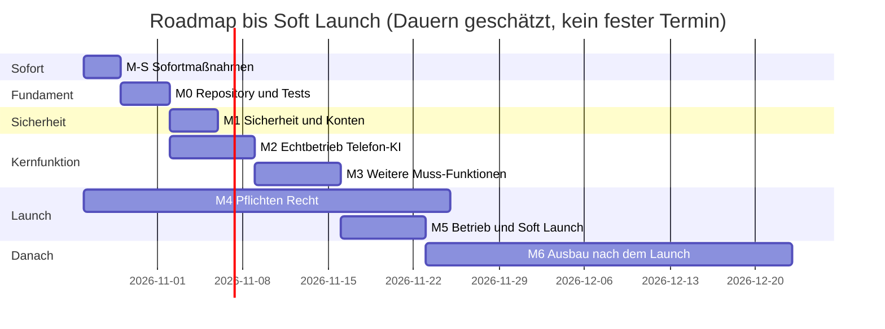

# Roadmap

> Phase 21 im Modus „Bestehende App“, Stand 2026-10-24. Reihenfolge nach `modes/bestehende-app.md`: erst offene hohe Befunde und Nachweise (M-S), dann Absicherung und Tests, dann Echtbetrieb der Kernfunktion, Pflichten und Launch. Neue Funktionen erst danach (M6).
> Bezüge: Funktionen `F-…` (`05-mvp.md`), Befunde `BF-…` (`B1-ist-analyse.md`), Audit-Punkte `OP-xx-yy` (Audit 2026-10-24, siehe `B2-soll-und-luecken.md`), Kriterien `AK-…` und Tests `TEST-…`/`T-SEC-…` (`19-tests.md`, `14-sicherheit.md`), Entscheidungen `E-…`, Screens `S…` (`07-screens.md`).
> Erledigte Aufgaben bleiben mit Status `erledigt` und Commit stehen – so bleibt nachvollziehbar, was am 2026-10-24 schon umgesetzt wurde.
> Größen: S < 1 Std. KI-Arbeit · M = halber bis ganzer Tag · L wurde weiter aufgeteilt. Viele offene Aufgaben brauchen **echte Konten, den Produktionsserver oder eine Fachperson** und lassen sich nicht allein mit dem Coding-Tool erledigen (Spalte „Sicherheit“ bzw. Titel nennt das).

Die Dauern sind grobe Schätzungen ohne festgelegtes Zeitbudget [ANNAHME A-002]. M4 läuft parallel, weil er vor allem auf Antworten von Anbietern und einer Fachperson wartet.

## Meilensteine
| Meilenstein | Ziel | Fertig, wenn |
|---|---|---|
| M-S Sofortmaßnahmen | Offene Punkte zu hohen Befunden und P0-Sicherheitslücken geschlossen | TASK-001–TASK-007 erledigt |
| M0 Fundament | Repository geschützt, Berechtigungen per HTTP- und E2E-Test belegt | TASK-008, TASK-009, TASK-006 erledigt, CI grün |
| M1 Sicherheit & Konten | Restlücken der Sicherheitsarchitektur zu | TASK-013, TASK-040, TASK-044, TASK-048, TASK-064, TASK-065, TASK-066 erledigt oder per `E-…` akzeptiert |
| M2 Kernfunktion | Telefon-KI mit echten Konten je Anbieter belegt | Testanruf-Protokoll vollständig (TASK-010, TASK-011), Fixtures und Latenz (TASK-061, TASK-062) |
| M3 Weitere Muss-Funktionen | Abrechnung, Kalender und Zustellung verkaufsfähig | TASK-016, TASK-017, TASK-025, TASK-027, TASK-063 |
| M4 Pflichten vor Launch | Verträge, Pflichttexte, DSFA, Aufzeichnung entschieden | TASK-030–TASK-039 |
| M5 Betrieb & Launch | Produktion läuft mit Nachweisen, Pilot startet | TASK-020–TASK-024, TASK-026, TASK-028, TASK-029, TASK-045–TASK-047, `pruefe-projekt.mjs --launch` ohne FEHLER |
| M6 Nach dem Launch | Ausbau | TASK-050 ff. nach Pilot-Rückmeldung priorisieren |

## Aufgaben
| ID | Meilenstein | Titel | Bezug | Akzeptanzkriterien | Sicherheit | Abhängig von | Größe | Status |
|---|---|---|---|---|---|---|---|---|
| TASK-001 | M-S | Kundendaten nur zur verifizierten Anrufernummer, Tools nur für laufende Anrufe, Geheimnis je Anbieter | F-01, F-03, OP-14-01, OP-14-02, OP-14-03, E-005, E-009, T-SEC-17, T-SEC-18, T-SEC-19, T-SEC-20 | AK-F03-1, AK-F03-2 | Regeln 2.1, 2.3, 8.4 | – | M | erledigt (Commit `8bdaa52`) |
| TASK-002 | M-S | Kundentyp `B2B_HACCP` → `BUSINESS`, Konsistenztest Agent-Tools ↔ Server-Schema | F-04, F-37, OP-15-02 | AK-F04-1, AK-F37-1 | – | – | S | erledigt (Commit `8bdaa52`) |
| TASK-003 | M-S | Benachrichtigungen aus dem Gesprächspfad, Wiederholung, Alarm bei Notfall-Fehlschlag | F-10, F-07, OP-15-03, E-011 | AK-F10-1, AK-F10-2 | Kostenlimit SMS | – | M | erledigt (Commit `4a1309e`) |
| TASK-004 | M-S | Twilio-Statusmeldung als Gesprächsende, hängende Anrufe schließen | F-23, F-27, OP-15-04, OP-17-03, OP-20-12, E-006 | AK-F23-1, AK-F27-1 | Webhook-Signatur | – | M | erledigt (Commit `7175b50`) |
| TASK-005 | M-S | `APP_ENCRYPTION_KEY` mit Schlüssel-ID und Rotation fertigstellen, committen, Incident-Plan §3 korrigieren | F-24, OP-14-07, OP-20-09, T-SEC-26 | AK-F24-1 | keine eigene Kryptografie (AES-256-GCM aus `node:crypto`) | – | M | in Arbeit (nicht committet) |
| TASK-006 | M-S | Repository privat stellen (oder E-022 bewusst entscheiden), `main` mit Branch-Schutz und Pflicht-Checks, Dependabot-Sicherheitsupdates an | BF-06, OP-13-02, OP-14-10, E-022 | Nachweis: `gh api` Ausgabe mit Datum | Regel 9.6 | Entscheidung Inhaber | S | offen (nur im GitHub-Konto möglich) |
| TASK-007 | M-S | Twilio-Signaturprüfung in Produktion nicht abschaltbar | F-01, OP-14-11, E-013, T-SEC-19 | AK-F01-2 | Webhook-Signatur | – | S | erledigt (Commit `bc90bbd`) |
| TASK-008 | M0 | HTTP-Tests je Endpunkt: fremder Mandant → 404, Mitarbeiter → 403 bei Einstellungen/Löschen, CSRF, Re-Auth, 2FA-Pflicht, Header | F-18, F-14, F-21, BF-11, OP-19-04, T-SEC-01, T-SEC-02, T-SEC-03, T-SEC-04, T-SEC-06, T-SEC-08, T-SEC-09, T-SEC-10, T-SEC-11, T-SEC-12, T-SEC-14, T-SEC-15, T-SEC-21, T-SEC-22, T-SEC-28 | AK-F18-1, AK-F18-2, AK-F14-2 | Zugriffs-Antwortstrategie (`docs/sicherheit.md`) | – | M | in Arbeit (T-SEC-HTTP-01…14 in `tests/e2e/http.test.ts`, Commits `7404f55`, `33c0708`; Build-Scan T-SEC-13 in CI; offen: Kunde/Anruf/Aufnahme lesen, T-SEC-11, Re-Auth für Export/Löschung/Mandantenwechsel) |
| TASK-009 | M0 | E2E-Tests (Playwright) in der CI: Login mit 2FA, Kunde anlegen, Einstellungen, Vorgang bearbeiten, Anruf ansehen, DSGVO-Export/-Löschung, Offboarding | F-12, F-13, F-14, F-15, F-16, F-18, F-19, F-21, F-22, F-24, OP-19-05, T-SEC-13 | AK-F12-1, AK-F13-1, AK-F15-1, AK-F16-1, AK-F19-1, AK-F21-1, AK-F22-1 | nur erfundene Testdaten | TASK-008 | M | offen |
| TASK-013 | M1 | Anrufe mit unterdrückter Nummer je angerufener Nummer und Stunde begrenzen (heute ausgenommen) | F-25, FL-05 | AK-F25-2 | Kostenlimit (Denial of Wallet) | – | S | erledigt im Code (Commit `7404f55`, 30/h je angerufener Nummer); automatischer Test TEST-F25-3 offen |
| TASK-014 | M1 | Kostenschutz und Kontingent-Warnungen 80/100 % | F-25, F-20, OP-14-05, OP-17-02, OP-05-03, E-014, T-SEC-07 | AK-F25-1, AK-F20-1 | Kostenlimit | – | M | erledigt (Commit `cbcdb54`) |
| TASK-015 | M1 | Paketgrenzen serverseitig durchsetzen | F-22, OP-05-05, T-SEC-16 | AK-F22-1 | Freischaltung nur serverseitig | – | M | erledigt (Commit `91e56ea`) |
| TASK-041 | M1 | Sicherheitsrelevante Rate-Limits gemeinsam in PostgreSQL | F-18, OP-14-06, E-012, T-SEC-05 | AK-F18-3 | Rate Limits laut `docs/sicherheit.md` | – | M | erledigt (Commit `136bc7f`) |
| TASK-065 | M1 | Bestätigungs-SMS nur an erlaubte Länder bzw. verifizierte Nummern; keine Durchstellung an vom Anrufer genannte Nummern (Toll-Fraud) | F-10, F-07, T-SEC-24 | T-SEC-24 grün | Kostenlimit SMS | – | S | teilweise erledigt (SMS nur in `SMS_ALLOWED_PREFIXES`, Limit 5 Benachrichtigungen je Vorgang/24 h: Commit `0e0efc5`); offen: `transfer_call` beim Anbieter auf feste Ziele (Anbieter-Konfiguration) |
| TASK-066 | M1 | Reset- und Einladungslinks für Kollegen nur nach Re-Auth erzeugen, Link nicht im Klartext anzeigen | F-18, T-SEC-29 | T-SEC-29 grün | Regel Re-Auth für sensible Aktionen | – | S | erledigt (Commit `0e0efc5`, Test T-SEC-HTTP-14 in `33c0708`) |
| TASK-040 | M1 | Major-Update Prisma 7 (`prisma.config.ts`, Treiber-Adapter) mit vollem Testlauf | BF-05, OP-14-09, E-003 | `npm audit` ohne hohen Prisma-Fund, CI grün | Regel 9.7 (Backup vor Migration) | TASK-008 | M | Kriterium erfüllt ohne Major-Update (Override `deepmerge-ts`, `npm audit --omit=dev` ohne Befund, Commit `859b8e0`); Prisma 7 selbst offen |
| TASK-064 | M1 | Major-Update Next 16 mit vollem Testlauf | BF-05, OP-14-09, OP-20-16, E-003 | `npm audit` ohne hohen next/postcss-Fund, CI grün | – | TASK-009 | M | Kriterium erfüllt ohne Major-Update (Override `postcss`, zod 4, Commit `859b8e0`); Next 16 selbst offen |
| TASK-044 | M1 | CSP auf Nonces umstellen oder E-001 vor Launch neu bestätigen | OP-14-08, E-001, BF-19 | Header-Test grün | Security-Header | – | M | offen |
| TASK-048 | M1 | Abgleich mit OWASP ASVS Level 1 dokumentieren | OP-14-15 | Abgleich-Tabelle in `14-sicherheit.md` | – | – | M | offen |
| TASK-010 | M2 | Testanruf-Protokoll (20 Szenarien, `docs/testanrufe.md`) mit Retell: KI-Offenlegung, Termin, Bestandskunde, Fremddaten, Notfall, Auflegen, FAQ-Zusagen, Prompt-Injection, Kontingent, Störung | F-01, F-02, F-03, F-04, F-05, F-07, F-08, F-09, BF-17, BF-23, OP-19-06, T-SEC-23, T-SEC-30 | AK-F01-1, AK-F02-1, AK-F05-1, AK-F07-1, AK-F07-2, AK-F08-1, AK-F09-1 | echte Konten, Testnummer, keine echten Kundendaten | TASK-020 oder Testumgebung mit Twilio-Nummer | M | offen (braucht echte Konten) |
| TASK-011 | M2 | Testanruf-Protokoll Szenarien 1–12 mit Vapi und ElevenLabs (inkl. `system__call_sid`, `x-call_ref`) | F-01, F-03, F-06, BF-17, OP-15-01 | AK-F01-1, AK-F06-1 | Geheimnis je Anbieter (E-005) | TASK-010 | M | offen (braucht echte Konten) |
| TASK-061 | M2 | Echte Tool-/Ereignis-Payloads je Anbieter anonymisiert als Fixtures unter `tests/fixtures/<anbieter>/`, Vertragstests | F-01, OP-19-02 | AK-F01-1 | Fixtures ohne personenbezogene Daten | TASK-010, TASK-011 | M | offen |
| TASK-062 | M2 | Latenz- und Gleichzeitigkeitstest mit echten Anbietern (Tarif-Grenzen, Twilio), Werte in `18-qualitaetsziele.md` | F-01, F-25, OP-18-02, OP-18-03 | Testanruf Nr. 19 mit Messwerten | Kostenlimit während Test | TASK-010 | M | in Arbeit (lokaler Lasttest `scripts/loadtest.ts` 2026-10-24: 10/30/60 gleichzeitig ohne Fehler, p95 207/444/816 ms; echte Anbieter offen) |
| TASK-012 | M2 | Löschung beim Anbieter mit echtem Konto belegen (Szenario 20: Retell, Twilio, Vapi, ElevenLabs) | F-27, BF-03 | AK-F27-1 | – | TASK-010 | S | offen |
| TASK-019 | M2 | Termine per Telefon verschieben/absagen | F-06, OP-05-04 | AK-F06-1 | nur verifizierte Nummer (E-009) | TASK-001 | M | erledigt (Commit `eb9dcbd`) |
| TASK-016 | M3 | Google-OAuth-Verifizierung (Kalender-Scope) und Microsoft Publisher Verification beantragen | F-05, F-17, OP-15-06, Q-023, Q-024 | AK-F17-1 | minimale Scopes | – | M | offen (Antragsverfahren) |
| TASK-017 | M3 | SPF, DKIM, DMARC für die Absenderdomain einrichten und nachweisen | F-10, OP-15-09 | Nachweis Header-Prüfung mit Datum | – | – | S | offen |
| TASK-018 | M3 | Agent-Einrichtung per API (Prompt/Tools versioniert, Version am Anruf) | F-37, OP-15-02 | AK-F37-1 | keine Secrets im Prompt | TASK-061 | M | offen |
| TASK-025 | M3 | Kostenrechnung je Minute mit Quellen in `17-kosten.md`, Standardkosten in `src/lib/billing.ts` ersetzen | F-23, OP-17-01, BF-10, Q-001, Q-002, Q-003, Q-004, Q-005 | AK-F23-1 | – | – | S | offen |
| TASK-027 | M3 | Echte Rechnungen: Nummernkreis, PDF, Archivierung | F-30, F-23, OP-15-07, OP-17-04, Q-016 | AK-F30-1 | Freischaltung nur serverseitig | TASK-025 | M | offen (Steuerberatung) |
| TASK-063 | M3 | Zahlung (SEPA-Lastschrift/Karte) über Zahlungsanbieter mit Webhook, Mahnwesen | F-30, OP-15-07 | AK-F30-1 | Regeln 8.1/8.2, Webhook-Signatur | TASK-027 | M | offen |
| TASK-030 | M4 | AVV/DPA mit IONOS, Twilio, Retell, Vapi, ElevenLabs, SMTP abschließen, datiert in `docs/recht/unterauftragsverarbeiter.md` | BF-07, OP-16-01, Q-009 | jede Zeile mit Datum | – | – | M | offen (Anbieter) |
| TASK-031 | M4 | Drittlandübermittlung je Anbieter prüfen (DPF-Status, SCC, TIA, Unterauftragnehmer, Trainingsausschluss) | BF-07, OP-16-02, Q-020 | schriftliche Antworten abgelegt | – | TASK-030 | M | offen (Anbieter) |
| TASK-032 | M4 | DSFA-Schwellwertprüfung inkl. Gesundheitsangaben in Transkripten; Pflicht zum Datenschutzbeauftragten prüfen | BF-07, BF-16, OP-16-08, Q-013, Q-017 | `docs/recht/dsfa.md` mit Ergebnis und Datum | – | – | S | offen (Fachperson) |
| TASK-033 | M4 | Entscheidung E-010 treffen (Aufzeichnung Standard aus), Standardwert im Code und Paket-Feature „Aufzeichnung“ daran koppeln | BF-04, OP-16-06, F-22, E-010, T-SEC-33 | AK-F02-1, AK-F22-1 | keine stille Aufzeichnung | Entscheidung Inhaber | S | offen |
| TASK-034 | M4 | Variante C (ausdrückliche Einwilligung) fertigstellen, testen, Löschung nach „Nein“ mit echtem Konto belegen | F-29, BF-04, OP-11-02 | AK-F29-1 | Löschung beim Anbieter | TASK-033, TASK-012 | M | in Arbeit (nicht committet) |
| TASK-035 | M4 | Impressum und Datenschutzerklärung ausfüllen, veröffentlichen, `LEGAL_IMPRINT_URL`/`LEGAL_PRIVACY_URL` setzen; AGB, Leistungsbeschreibung, SLA final | OP-16-04, OP-16-05, S42 | Links in S42 sichtbar | – | TASK-037 | M | offen (Fachperson) |
| TASK-036 | M4 | Datenexport und Löschung eines Mandanten auf Produktion prüfen; Aufbewahrung von Abrechnungsdaten bei der Löschung ausnehmen | F-14, F-27, BF-15, OP-16-13, Q-016 | AK-F14-1, AK-F27-2 | Re-Auth, Audit-Log | TASK-020 | S | in Arbeit (Abrechnungsdaten bleiben: `BillingSnapshot`, Schlussabrechnung vor Mandanten-Löschung, Anonymisieren statt Löschen – Commit `48e363a`; Prüfung auf Produktion offen) |
| TASK-037 | M4 | Rechtsunterlagen (VVT, TOM, Datenschutz, Löschkonzept, AVV-Vorlage) um Vapi, ElevenLabs, Google ergänzen; 54 PRÜFEN-Markierungen fachlich klären lassen | OP-16-03, OP-16-07, BF-07 | 0 offene PRÜFEN-Markierungen | – | – | M | offen (Fachperson) |
| TASK-038 | M4 | KI-Kompetenz (Art. 4 KI-VO): Schulungsnachweis Betreiber, Kurzanleitung für Kunden | OP-16-09, Q-019 | Nachweis mit Datum | – | – | S | offen |
| TASK-039 | M4 | Einwilligung bzw. Rechtsgrundlage für SMS-Bestätigungen und -Erinnerungen klären; Abbestellen ermöglichen | F-11, F-10, OP-16-10, OP-18-05, Q-014, T-SEC-32 | AK-F11-1 | keine Gesundheitsangaben in SMS | – | S | offen |
| TASK-042 | M4 | Barrierefreiheit: Kontraste messen (hell/dunkel), Feldbeschriftungen prüfen, Tastatur-Durchgang S01/S10/S11/S12/S14/S21 | BF-18, OP-10-01, OP-10-02, OP-09-01 | Checkliste in `10-barrierefreiheit.md` ausgefüllt | – | – | M | offen |
| TASK-043 | M4 | Automatischer a11y-Check (axe) in der CI | OP-19-08, OP-10-02 | CI-Schritt grün | – | TASK-009 | S | offen |
| TASK-020 | M5 | IONOS-VPS aufsetzen, `deploy/harden.sh` ausführen, Nachweise (ufw, sshd, fail2ban, unattended-upgrades) mit Datum; getrennte Schlüssel je Umgebung | OP-20-01, OP-20-02, OP-20-13, E-016 | Nachweise in `docs/betrieb.md` | Secrets nur in `.env` (600) | TASK-006 | M | offen (Server) |
| TASK-021 | M5 | Backups auf Produktion einrichten (age-Schlüssel, S3-Bucket), ersten Wiederherstellungstest nachweisen | F-28, BF-09, OP-20-04, T-SEC-25 | AK-F28-1 | Schlüssel getrennt im Tresor | TASK-020 | S | offen (Server) |
| TASK-022 | M5 | Externen Lebenszeichen-Dienst und Uptime-Check einrichten, `ALERT_*` setzen, Testalarm | F-26, BF-08, OP-20-05 | AK-F26-1 | Alarme ohne personenbezogene Daten | TASK-020 | S | offen (Server) |
| TASK-023 | M5 | TwiML Bin je Nummer bei Twilio als Ersatzziel setzen, Szenario 18 (Server aus) testen | F-09, OP-20-03, E-007, Q-006, T-SEC-31 | AK-F09-2 | – | TASK-020 | S | offen (Twilio-Konsole) |
| TASK-024 | M5 | Budget-Grenzen und Ausgabenalarme in Twilio, Retell, Vapi, ElevenLabs setzen und dokumentieren | F-25, BF-10, OP-15-08 | Nachweis je Konto mit Datum | Kostenlimit beim Anbieter | – | S | offen (Anbieter-Konten) |
| TASK-026 | M5 | Versions-Tags je Release, Rollback einmal üben, Staging mit Testnummer | BF-22, OP-20-07 | Rollback-Protokoll mit Datum | – | TASK-020 | M | offen |
| TASK-028 | M5 | Support-Playbook, Release-Checkliste, Bereitschaft und Vertretung (Notfall-Weiterleitung braucht Erreichbarkeit) | OP-20-06, OP-20-08 | Dokumente in `docs/` | Identitätsprüfung im Support | – | S | offen |
| TASK-029 | M5 | 2FA auf allen Betreiberkonten (GitHub, IONOS, Twilio, Retell, Vapi, ElevenLabs, Netlify, Google Cloud, Entra, Registrar, SMTP) mit Nachweis | OP-20-10 | Liste mit Datum | Wiederherstellungscodes sicher ablegen | – | S | offen |
| TASK-045 | M5 | Launch-Gate: `pruefe-projekt.mjs --launch` ohne FEHLER, Soft Launch mit 1–2 Pilotbetrieben, Abbruchkriterium | E-020, E-021, OP-23-01, OP-23-02 | `23-launch.md` freigabefähig | externe Prüfung oder E-021 | M2–M4 | M | offen |
| TASK-046 | M5 | Testkonten/Testdaten aus Produktion entfernen, Feedback-Kanal einrichten | OP-23-03, E-019 | Nachweis mit Datum | – | TASK-020 | S | offen |
| TASK-047 | M5 | Vertriebsgrundlagen: Landingpage mit Leistungen und Preisen, Vertragsweg, Onboarding-Checkliste (Rufumleitung je Anbieter, Testanruf) | OP-23-04 | Seite online | – | TASK-035 | M | offen |
| TASK-049 | M5 | Externe Fachprüfung (Pentest/Code-Review) beauftragen oder Risiko als E-021 bewusst akzeptieren | E-021, E-017 | Bericht `pruefungen/externe-pruefung-….md` oder E-021 „akzeptiert“ | – | TASK-045 | M | offen (Entscheidung Inhaber) |
| TASK-050 | M6 | Self-Service: Paketwechsel und „Mehr Minuten buchen“ | F-31, OP-05-06 | – | Freischaltung nur nach Zahlung | TASK-063 | M | offen |
| TASK-051 | M6 | Rufnummern per API konfigurieren (Voice-URL, Status-URL, Ersatzziel), später Kauf/Portierung, sipgate | F-32, OP-05-07 | – | – | – | M | offen |
| TASK-052 | M6 | i18n einführen, Stimme und Sprache je Kunde (DE/EN/TR) | F-33, OP-05-08, OP-10-03 | – | – | – | M | offen (weiter aufteilen) |
| TASK-053 | M6 | Ausgehende Anrufe (Rückruf) – erst nach UWG-Klärung | F-34, OP-05-09, OP-16-10 | – | Einwilligung | TASK-039 | M | offen (weiter aufteilen) |
| TASK-054 | M6 | Weitere Anbindungen (CalDAV, CRM, Webhooks für Kunden) | F-35, OP-05-11 | – | Daten an Dritte nur nach AVV | – | M | offen (weiter aufteilen) |
| TASK-055 | M6 | Abwesenheiten/Urlaub im internen Kalender | F-36, OP-05-10 | – | – | – | M | offen |
| TASK-056 | M6 | Öffentliche Statusseite | F-38, OP-20-14 | – | – | TASK-022 | S | offen |
| TASK-057 | M6 | Postgres-RLS als zweite Schutzschicht | E-004, BF-13, OP-14-14 | – | – | TASK-040 | M | offen (vor 10 Kunden) |
| TASK-058 | M6 | Microsoft-Graph: Application Access Policy empfehlen, in TOM/AVV beschreiben | F-17, OP-14-13 | – | minimale Rechte | – | S | offen |
| TASK-059 | M6 | Regel für Support-Zugriff (Zustimmung/Benachrichtigung des Kunden) festlegen | F-21, OP-12-02 | – | Audit-Log | – | S | offen |
| TASK-060 | M6 | Aufräumen: alte Schema-Datei `prisma/postgres/schema.prisma`, README aktualisieren, CHANGELOG und Versionen, Wartungsroutine, Log-Aufbewahrung | OP-11-03, OP-22-02, OP-24-01, OP-24-02, OP-20-15 | – | – | – | S | offen |

## Umfang und Zeitbudget
Ein Zeitbudget ist nicht festgelegt [ANNAHME A-002]. Ehrlich: Programmieraufwand bis zum Soft Launch ist überschaubar (TASK-005, 008, 009, 013, 018, 025, 027, 063 und die Major-Updates). Der kritische Pfad sind **externe Schritte**: echte Anbieter-Konten und Testnummer (M2), Produktionsserver (M5), Verträge und Fachprüfung (M4), Google-/Microsoft-Verifizierung (M3). Wer schneller starten will, kann TASK-027/TASK-063 (echte Rechnungen) für 1–2 Pilotbetriebe durch manuelle Rechnungen ersetzen – das wäre eine Entscheidung `E-…`.

## Rückverfolgung (Ergänzung zu `19-tests.md`)
| Muss-Funktion | Aufgaben |
|---|---|
| F-01 | TASK-001, TASK-007, TASK-010, TASK-011, TASK-061, TASK-062 |
| F-02 | TASK-010, TASK-033 |
| F-03 | TASK-001, TASK-010, TASK-011 |
| F-04 | TASK-002, TASK-010 |
| F-05 | TASK-010, TASK-016 |
| F-07 | TASK-003, TASK-010 |
| F-08 | TASK-010 |
| F-09 | TASK-010, TASK-023 |
| F-10 | TASK-003, TASK-017, TASK-039, TASK-065 |
| F-12 | TASK-009 |
| F-13 | TASK-009 |
| F-14 | TASK-008, TASK-009, TASK-036 |
| F-15 | TASK-009 |
| F-16 | TASK-009 |
| F-18 | TASK-008, TASK-009, TASK-041, TASK-066 |
| F-19 | TASK-009 |
| F-20 | TASK-014 |
| F-21 | TASK-008, TASK-009, TASK-059 |
| F-22 | TASK-009, TASK-015, TASK-033 |
| F-23 | TASK-004, TASK-025, TASK-027 |
| F-24 | TASK-005, TASK-009 |
| F-25 | TASK-013, TASK-014, TASK-024, TASK-062 |
| F-26 | TASK-022 |
| F-27 | TASK-004, TASK-012, TASK-036 |
| F-28 | TASK-021 |

Hohe Befunde aus B1: BF-01, BF-02 (behoben, siehe `B2-soll-und-luecken.md`), BF-03 → TASK-012, BF-04 → TASK-033, TASK-034, BF-05 → TASK-040, TASK-064 (E-003), BF-06 → TASK-006, BF-07 → TASK-030, TASK-031, TASK-032, TASK-037.
